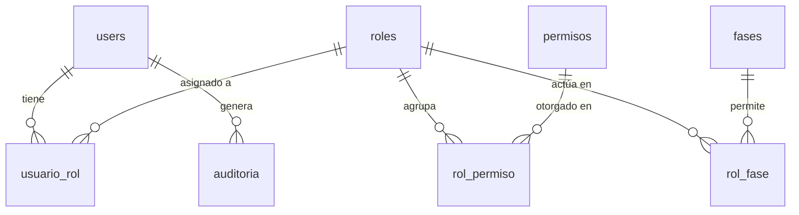
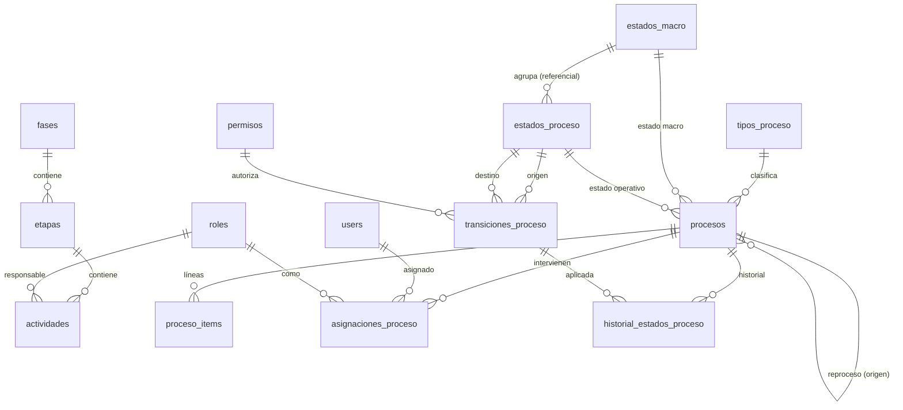
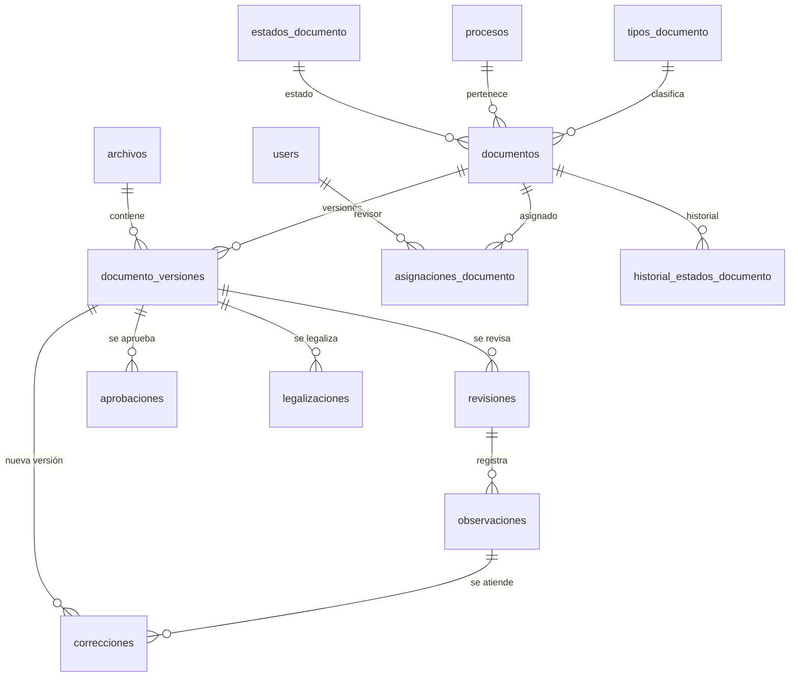

# Entrega A — Arquitectura de datos (Etapa 3)

Sistema de Contratación Pública por Fases — AIL E.P.
Stack verificado: PHP 8.3 · Laravel 13.43 · Filament 4.16 · PostgreSQL 16.

> Estado: **v2, ajustada con tus respuestas**. El script SQL (`database/sql/01_esquema_contratacion.sql`) es ahora la fuente de verdad de columnas y restricciones; este documento explica las decisiones.
> Fuente principal: modelo Bizagi. El Excel es solo referencia de campos.

### Cambios de v2 respecto a v1

| # | Cambio | Motivo |
|---|---|---|
| 1 | Roles: `COMPRAS` se separa en `COMPRAS_JEFE` (recibe y asigna) y `COMPRAS_ANALISTA` (revisa y publica; puede ser otra persona distinta del revisor, por eso las asignaciones son por actividad). Total 10 roles. | Respuesta 7. |
| 2 | Fase Contractual limitada a: orden de compra, entregas (fecha, responsable, cantidades), administrador de contrato y documentos de cierre. El pago y el acta no se modelan como flujo; solo existen como **tipos de documento**. | Respuestas 2 y 6. |
| 3 | Nueva tabla `devoluciones` (memorando, motivo, `reapertura_permitida`). `reabrir` solo procede si la última devolución lo autoriza; si no, solo `cerrar_sin_reapertura`. El analista de Compras ejecuta estas transiciones. | Respuesta 3. |
| 4 | `procesos.proceso_origen_id` desaparece. Reabrir usa **el mismo proceso** con `procesos.ciclo` (+1) y `publicaciones.ciclo`. El código NC puede repetirse entre ciclos. | Respuestas 3 y 4. |
| 5 | `procesos.codigo` es **nullable**: lo asigna Compras antes de publicar (Bizagi: "Asignar responsable y número de proceso"). | Bizagi. |
| 6 | Nueva tabla `transicion_proceso_requisitos`: documentos requeridos por transición (tipo + estado mínimo). Hoy vacía; se llena desde la aplicación cuando definan los obligatorios. | Respuesta 5. |
| 7 | Permiso nuevo `expedientes.descargar` para el formulario de descarga masiva de documentos del proceso (los usuarios autorizados se definirán). | Respuesta 5. |
| 8 | `ofertas.publicacion_id` pasa a obligatorio. `estados_documento.grupo` y `estados_oferta.resultado` permiten reportes sin comparar códigos. | Diseño. |
| 9 | `entregas.responsable_id` (administrador de contrato que registra). | Respuesta 2. |
| 10 | Transiciones de proceso: 19 (se elimina `solicitar_reapertura` desde Cierre y se agrega `cerrar_sin_reapertura`). | Respuesta 3. |

**Total: 49 tablas nuevas**, más `users` y las de Laravel.

---

## 1. Convenciones

| Tema | Regla |
|---|---|
| Nombres | Tablas y columnas en español, minúsculas, `snake_case`, plural en tablas (`proveedores`, `publicaciones`). Sin prefijos de columna. |
| Excepción de framework | `users` (con `email`, `password`) y `created_at` / `updated_at` / `deleted_at` se mantienen por compatibilidad con Laravel. |
| Claves | `id` bigint identidad. Foráneas `<singular>_id`. Usuarios: `user_id`. |
| Fechas | `timestamptz`. Se guardan en UTC y se muestran en `America/Guayaquil`. |
| Dinero y cantidades | `numeric(14,4)` para precios unitarios, `numeric(16,2)` para totales, `integer`/`bigint` para cantidades. |
| Catálogos | Tablas configurables con `codigo` (estable, usado por el código) y `nombre` (editable). El código PHP nunca compara nombres. |
| Inmutabilidad | Tablas históricas son *append-only*: un trigger bloquea `UPDATE` y `DELETE` (ver §9). |
| Estados | Tres ámbitos independientes: **proceso**, **documento**, **oferta**. Cada uno con su catálogo, sus transiciones y su historial. |
| Permisos | `modulo.accion` en minúsculas, p. ej. `documentos.solicitar_correccion`. |

---

## 2. Diagramas entidad-relación

### 2.1 Seguridad

### 2.2 Flujo y procesos

### 2.3 Gestión documental

### 2.4 Proveedores, ofertas y contratación

---

## 3. Diccionario de datos

Notación: **PK**, *FK*, `U` único, `N` nullable. Se omiten `created_at`/`updated_at` salvo en tablas append-only (solo `created_at`).

### 3.1 Seguridad y administración

| Tabla | Columnas | Notas |
|---|---|---|
| `users` | `id`, `name`, `email` U, `password`, `cedula` U N, `cargo` N, `unidad` N, `activo` bool | Ya existe. Se conserva. |
| `roles` | `id`, `codigo` U, `nombre`, `descripcion` N, `es_sistema` bool, `activo` bool | `es_sistema` impide borrar roles base. |
| `permisos` | `id`, `codigo` U, `nombre`, `descripcion` N, `modulo`, `requiere_asignacion` bool, `activo` bool | `requiere_asignacion`: la Policy exige que el registro esté asignado al usuario (ver §7). |
| `rol_permiso` | *rol_id*, *permiso_id* — PK compuesta | |
| `usuario_rol` | *user_id*, *rol_id* — PK compuesta | Un usuario puede tener varios roles. |
| `rol_fase` | *rol_id*, *fase_id* — PK compuesta | Acceso por fase: un rol solo opera en las fases listadas. |
| `parametros` | `id`, `clave` U, `valor`, `tipo`, `descripcion` | Reglas numéricas configurables (§6). |
| `auditoria` | `id`, *user_id* N, `evento`, `entidad`, `entidad_id` N, `valores_anteriores` jsonb N, `valores_nuevos` jsonb N, `ip` N, `agente` N, `created_at` | Append-only. Incluye login, descargas y exportaciones (`evento` = `documento.descargado`, `reporte.exportado`…). |

### 3.2 Configuración de flujo

| Tabla | Columnas | Notas |
|---|---|---|
| `fases` | `id`, `codigo` U, `nombre`, `orden`, `activo` | Preparatoria, Precontractual, Contractual. |
| `estados_macro` | `id`, `codigo` U, `nombre`, `orden`, *fase_id* N | 4 filas: Preparatoria, Precontractual, Contractual, Finalizado. |
| `etapas` | `id`, *fase_id*, `codigo` U, `nombre`, `orden`, `activo` | Agrupan actividades. |
| `actividades` | `id`, *etapa_id*, `codigo` U, `nombre`, `tipo` (`tarea`/`subproceso`/`decision`), `orden`, *rol_id* N, `activo` | Traducción de Bizagi a datos. `rol_id` = carril responsable. |
| `estados_proceso` | `id`, `codigo` U, `nombre`, `orden`, `es_inicial`, `es_final`, `color` N, `activo` | Estados operativos configurables. |
| `transiciones_proceso` | `id`, *estado_origen_id* N, *estado_destino_id*, `codigo`, `nombre`, *estado_macro_destino_id* N, *permiso_id*, `requiere_comentario`, `requiere_documento_aprobado`, `validaciones` jsonb N, `activo` | U(`estado_origen_id`,`codigo`). `estado_origen_id` NULL = creación. `estado_macro_destino_id` NULL = no cambia el macro. |
| `historial_estados_proceso` | `id`, *proceso_id*, *transicion_id*, *estado_origen_id* N, *estado_destino_id*, *estado_macro_id*, *user_id*, `comentario` N, `created_at` | Append-only. |
| `estados_documento` | `id`, `codigo` U, `nombre`, `orden`, `es_inicial`, `es_final`, `activo` | |
| `transiciones_documento` | misma estructura que `transiciones_proceso`, sin macro | |
| `historial_estados_documento` | `id`, *documento_id*, *transicion_id*, origen, destino, *user_id*, `comentario` N, `created_at` | Append-only. |
| `estados_oferta` | `id`, `codigo` U, `nombre`, `orden`, `es_inicial`, `es_final`, `activo` | |
| `transiciones_oferta` | misma estructura | |
| `historial_estados_oferta` | `id`, *oferta_id*, *transicion_id*, origen, destino, *user_id*, `comentario` N, `created_at` | Append-only. |
| `tipos_proceso` | `id`, `codigo` U, `nombre`, `activo` | Bizagi: "Seleccionar el tipo de proceso (Abastecimiento Centralizado)". |
| `tipos_designacion` | `id`, `codigo` U, `nombre`, `monto_minimo` numeric N, `orden`, `activo` | Reemplaza el `IF` del Excel (col. AD). Umbrales editables. |

### 3.3 Procesos y asignaciones

| Tabla | Columnas | Notas |
|---|---|---|
| `procesos` | `id`, `codigo` U, *tipo_proceso_id*, `anio` smallint, `descripcion_producto`, `codigo_cpc` N, `numero_pedido` smallint default 1, *proceso_origen_id* N, *estado_macro_id*, *estado_proceso_id*, `observacion` N, *creado_por* (user_id), `deleted_at` N | `proceso_origen_id`: reproceso/reapertura (006 → 070). |
| `proceso_items` | `id`, *proceso_id*, `numero_linea`, `cum`, `descripcion`, `cantidad` bigint | U(`proceso_id`,`numero_linea`). Líneas de producto. |
| `precios_referenciales` | `id`, *proceso_item_id*, *proveedor_id* N, `fuente`, `precio_unitario` | Excel "PRECIOS MSP" (K, L). `fuente` por confirmar. |
| `asignaciones_proceso` | `id`, *proceso_id*, *user_id*, *rol_id*, *fase_id*, *etapa_id* N, *actividad_id* N, *asignado_por*, `fecha_inicio`, `fecha_fin` N, `activo` | Quién interviene en cada fase/etapa del proceso. Base del control "por responsable". |

### 3.4 Gestión documental

| Tabla | Columnas | Notas |
|---|---|---|
| `tipos_documento` | `id`, `codigo` U, `nombre`, *fase_id* N, *etapa_id* N, *rol_generador_id* N, *rol_revisor_id* N, `requiere_revision`, `requiere_aprobacion`, `requiere_legalizacion`, `extensiones_permitidas`, `tamano_maximo_mb`, `activo` | Configurable sin tocar código. |
| `archivos` | `id`, `disco`, `ruta`, `nombre_original`, `nombre_interno` U, `extension`, `mime`, `tamano_bytes`, `hash_sha256`, *user_id*, `created_at` | Append-only. Sin binarios en BD. |
| `documentos` | `id`, *proceso_id*, *tipo_documento_id*, *etapa_id* N, *estado_documento_id*, *version_actual_id* N, `titulo`, `numero_documento` N, `fecha_documento` N, *oferta_id* N, *designacion_id* N, *creado_por*, `deleted_at` N | `numero_documento` = código institucional (p. ej. memorandos). `oferta_id`/`designacion_id` enlazan documentos a ofertas y designaciones. |
| `documento_versiones` | `id`, *documento_id*, `numero_version`, *archivo_id*, *user_id*, `comentario` N, `created_at` | U(`documento_id`,`numero_version`). Append-only: **nunca se sobrescribe**. |
| `asignaciones_documento` | `id`, *documento_id*, *user_id*, `tarea` (`revisar`/`corregir`), *asignado_por*, `fecha_asignacion`, `fecha_fin` N, `activo` | Base de "solo revisa lo que le asignaron". |
| `revisiones` | `id`, *documento_version_id*, `numero_revision`, *revisor_id* (user), `resultado` (`aprobada`/`con_observaciones`), `fecha_inicio`, `fecha_fin` N, `created_at` | Append-only. |
| `observaciones` | `id`, *revision_id*, `tipo` (`observacion`/`recomendacion`), `texto`, *user_id*, `created_at` | Append-only. |
| `correcciones` | `id`, *observacion_id*, *documento_version_id* (versión que corrige), *user_id*, `descripcion`, `created_at` | Append-only. |
| `aprobaciones` | `id`, *documento_version_id*, *user_id*, `comentario` N, `created_at` | Append-only. |
| `legalizaciones` | `id`, *documento_version_id*, *user_id*, *archivo_id* N (documento firmado), `observacion` N, `created_at` | Append-only. |

### 3.5 Proveedores, ofertas y contratación

| Tabla | Columnas | Notas |
|---|---|---|
| `proveedores` | `id`, `ruc` U N, `razon_social`, `activo`, `deleted_at` N | RUC nullable: el Excel solo tiene nombre hasta la OC. |
| `proveedor_alias` | `id`, *proveedor_id*, `alias` U | Mapea "PEZCAL" ↔ razón social para la importación. |
| `publicaciones` | `id`, *proceso_id*, `secuencia` smallint, `codigo_nc`, `enlace` N, `fecha_publicacion`, `fecha_limite`, `observacion` N | U(`proceso_id`,`secuencia`). Excel AG–AK y AL–AP. `codigo_nc` **no** es único global (006 y 070 lo comparten). |
| `ofertas` | `id`, *proceso_id*, *publicacion_id* N, *proveedor_id*, *estado_oferta_id*, `fecha_presentacion` N, `observacion` N, `deleted_at` N | U(`proceso_id`,`proveedor_id`,`publicacion_id`). Excel M–Z. |
| `oferta_items` | `id`, *oferta_id*, *proceso_item_id*, `precio_unitario` | U(`oferta_id`,`proceso_item_id`). Totales **calculados** en vistas. |
| `oferta_evaluaciones` | `id`, *oferta_id*, *evaluador_id* (user), `cumple` bool, `seleccionada` bool, `motivo` N, `created_at` | Append-only. |
| `designaciones` | `id`, *proceso_id*, *tipo_designacion_id*, `monto_referencia` N, `fecha` N, `observacion` N | Excel AD–AF. Memorandos = filas en `documentos` con `designacion_id`. |
| `designacion_miembros` | `id`, *designacion_id*, *user_id*, *rol_id* | Integrantes de la Comisión / delegado / financiero / jurídico. |
| `ordenes_compra` | `id`, *proceso_id*, *oferta_id*, *proveedor_id*, `numero` N, `fecha_orden`, `representante_legal` N, `administrador_nombre` N, `administrador_correo` N, *administrador_user_id* N | Excel AQ–AV. El administrador puede no ser usuario del sistema. |
| `entregas` | `id`, *orden_compra_id*, `numero_entrega`, `fecha_entrega`, `observacion` N | U(`orden_compra_id`,`numero_entrega`). Excel AW–BD. Normaliza "Entrega 1/2". |
| `entrega_items` | `id`, *entrega_id*, *proceso_item_id*, `cantidad`, `precio_unitario` | Total de entrega calculado. |

**Total: 47 tablas nuevas**, más `users` (existente) y las de Laravel (`sessions`, `cache`, `jobs`, etc.).

---

## 4. Cobertura del Excel (56 columnas)

| Columnas | Destino |
|---|---|
| A (Item) | Descartada: es un contador; el identificador es `procesos.codigo`. |
| B | `procesos.codigo` |
| C | `procesos.codigo_cpc` |
| D | `procesos.descripcion_producto` |
| E | `proceso_items.detalle` |
| F | `proceso_items.cum` |
| G | `proceso_items.cantidad` |
| H | `estados_proceso` (mapeo en §5) |
| I | `asignaciones_proceso` (rol analista responsable) |
| J | `procesos.numero_pedido` |
| K, L | `precios_referenciales` |
| M–Z | `ofertas`, `oferta_items`, `proveedores`, `proveedor_alias` |
| O, P, S, T, W, X, AA, AB | Calculados en vistas (no se almacenan) |
| AC | Regla: `parametros.minimo_proformas` |
| AD | `tipos_designacion` + `designaciones` |
| AE, AF | `documentos.numero_documento` (memorandos) con `designacion_id` |
| AG–AJ, AL–AO | `publicaciones` (secuencia 1 y 2) |
| AK, AP | Calculados: conteo de `ofertas` por publicación |
| AQ–AV | `ordenes_compra` |
| AW–BC | `entregas`, `entrega_items` |
| BD | `procesos.observacion` / `ordenes_compra` (por confirmar) |

---

## 5. Catálogo de estados (referencial, configurable)

### 5.1 Estados macro

`PREPARATORIA` · `PRECONTRACTUAL` · `CONTRACTUAL` · `FINALIZADO`

El macro **no se deduce del estado operativo**: cambia solo cuando una transición lo indica (`estado_macro_destino_id`). Esto resuelve que "En revisión" y "En corrección" ocurren en dos fases: la revisión del expediente la hace Compras (carril Precontractual en Bizagi) sobre un expediente generado en Preparatoria.

### 5.2 Estados operativos de proceso

| Orden | Código | Nombre | Inicial | Final |
|---|---|---|---|---|
| 1 | `INICIO` | Inicio | ✔ | |
| 2 | `EN_REVISION` | En revisión | | |
| 3 | `EN_CORRECCION` | En corrección | | |
| 4 | `PARA_LEGALIZAR` | Para legalizar | | |
| 5 | `PARA_PUBLICAR` | Para publicar | | |
| 6 | `PUBLICADO` | Publicado | | |
| 7 | `PARA_COMISION` | Para Comisión | | |
| 8 | `EN_COMISION` | En comisión | | |
| 9 | `APROBADO` | Aprobado | | |
| 10 | `GENERACION_EXPEDIENTE` | Generación de Expediente | | |
| 11 | `GENERACION_ORDEN_COMPRA` | Generación de Orden de Compra | | |
| 12 | `ADMINISTRACION_CONTRATO` | Administración de Contrato | | |
| 13 | `CIERRE` | Cierre | | ✔ |
| 14 | `PARA_REAPERTURA` | Para reapertura | | |

Mapeo del Excel: `EN PROCESO` → según avance real del proceso; `PROCESO DEVUELTO` → `PARA_REAPERTURA`.

### 5.3 Transiciones de proceso (semilla inicial)

| # | Origen → Destino | Código | Permiso | Macro destino | Origen en Bizagi / validación |
|---|---|---|---|---|---|
| 1 | ∅ → INICIO | `crear` | `procesos.crear` | Preparatoria | Evento inicio + "Seleccionar tipo de proceso". |
| 2 | INICIO → EN_REVISION | `enviar_a_revision` | `procesos.enviar_a_revision` | — | Genera expediente preparatorio. Exige documentos del expediente cargados. |
| 3 | EN_REVISION → EN_CORRECCION | `solicitar_correcciones` | `documentos.solicitar_correccion` | — | "Notificar observaciones". Comentario obligatorio. |
| 4 | EN_CORRECCION → EN_REVISION | `reenviar_a_revision` | `procesos.enviar_a_revision` | — | Ciclo de corrección. Exige nueva versión de documentos observados. |
| 5 | EN_REVISION → PARA_LEGALIZAR | `validar_documentacion` | `documentos.aprobar` | — | "¿Correcto y completo?" = sí. Sin observaciones pendientes. |
| 6 | PARA_LEGALIZAR → PARA_PUBLICAR | `autorizar_publicacion` | `procesos.autorizar_transicion` | Precontractual | "Solicitar publicación". Documentos legalizados. |
| 7 | PARA_PUBLICAR → PUBLICADO | `publicar` | `publicaciones.registrar` | — | Exige responsable asignado y publicación registrada (NC). |
| 8 | PUBLICADO → PUBLICADO | `republicar` | `publicaciones.registrar` | — | Si ofertas < mínimo y publicaciones < máximo. |
| 9 | PUBLICADO → PARA_COMISION | `enviar_a_comision` | `procesos.autorizar_transicion` | — | Ofertas ≥ mínimo, o ≥ 1 tras agotar publicaciones. |
| 10 | PUBLICADO → PARA_REAPERTURA | `devolver_expediente` | `procesos.autorizar_transicion` | — | 0 ofertas tras agotar publicaciones. "Memorando de devolución". |
| 11 | PARA_COMISION → EN_COMISION | `iniciar_comision` | `designaciones.registrar` | — | Designación registrada (tipo según monto). |
| 12 | EN_COMISION → APROBADO | `aprobar_seleccion` | `ofertas.seleccionar` | — | Oferta seleccionada y informe aprobado. |
| 13 | EN_COMISION → PARA_REAPERTURA | `recomendar_devolucion` | `ofertas.evaluar` | — | "No existe proforma seleccionable". |
| 14 | APROBADO → GENERACION_EXPEDIENTE | `generar_expediente` | `procesos.autorizar_transicion` | — | Consolidación de documentación habilitante. |
| 15 | GENERACION_EXPEDIENTE → GENERACION_ORDEN_COMPRA | `generar_orden_compra` | `ordenes_compra.registrar` | — | Reasigna expediente para OC. |
| 16 | GENERACION_ORDEN_COMPRA → ADMINISTRACION_CONTRATO | `iniciar_administracion` | `ordenes_compra.registrar` | Contractual | OC registrada y administrador asignado. |
| 17 | ADMINISTRACION_CONTRATO → CIERRE | `cerrar` | `procesos.cerrar` | Finalizado | Entregas y acta registradas. |
| 18 | CIERRE → PARA_REAPERTURA | `solicitar_reapertura` | `procesos.reabrir` | — | Comentario obligatorio. |
| 19 | PARA_REAPERTURA → INICIO | `reabrir` | `procesos.reabrir` | Preparatoria | Ver pregunta 3. |

Las validaciones de la columna final se guardan como reglas declarativas en `transiciones_proceso.validaciones` (jsonb), p. ej. `{"minimo_ofertas": "parametro:minimo_proformas"}`. Cambiar un flujo es editar filas, no código.

### 5.4 Estados de documento

`BORRADOR` → `PENDIENTE_REVISION` → `EN_REVISION` → (`CON_OBSERVACIONES` → `EN_CORRECCION` → `PENDIENTE_REVISION`)* → `APROBADO` → `LEGALIZADO` · `ANULADO`

Transiciones: `cargar_version`, `asignar_revisor`, `iniciar_revision`, `registrar_observaciones`, `cargar_correccion`, `aprobar`, `legalizar`, `anular`. Se repite el ciclo tantas veces como haga falta; cada vuelta crea una `revision` y una `documento_version` nuevas.

### 5.5 Estados de oferta

`RECIBIDA` → `EN_EVALUACION` → `ACLARACION_SOLICITADA` → `SELECCIONABLE` / `NO_SELECCIONABLE` → `SELECCIONADA` → `ADJUDICADA`

---

## 6. Parámetros iniciales (`parametros`)

| Clave | Valor | Origen |
|---|---|---|
| `minimo_proformas` | 3 | Excel AC. Bizagi: "número de ofertas solicitado". |
| `maximo_publicaciones` | 2 | Excel (Publicación 1 y 2). **Por confirmar.** |
| `tamano_maximo_documento_mb` | 20 | Propuesto. |

Umbrales de designación (100.000 y 500.000) viven en `tipos_designacion.monto_minimo`: `DELEGADO` (0), `COMISION` (100.000), `COMISION_FINANCIERO_JURIDICO` (500.000).

---

## 7. Roles y matriz de permisos

### 7.1 Roles iniciales (referenciales)

`ADMIN` Administrador del sistema · `UNIDAD_REQUIRENTE` · `COMPRAS` · `COMISION_TECNICA` · `SERVIDOR_AFIN` (delegado) · `FINANCIERO` · `JURIDICO` · `ADMIN_CONTRATO` · `CONSULTA`

Derivados de los carriles de Bizagi (Unidad Requirente, Compras, Comisión Técnica) y de la columna AD del Excel (delegado, financiero, jurídico). Son ajustables.

### 7.2 Autorización: tres capas

1. **Permiso por rol** (`rol_permiso`): ¿puede hacer esta acción?
2. **Fase** (`rol_fase`): ¿su rol opera en esta fase?
3. **Asignación**: si `permisos.requiere_asignacion = true`, la Policy exige una fila activa en `asignaciones_proceso` o `asignaciones_documento` para ese usuario y registro.

Ejemplo: `documentos.revisar` tiene `requiere_asignacion = true`. Un usuario con ese permiso solo revisa documentos que le asignaron.

El **acceso a un módulo** es el permiso `*.ver`. La **ejecución de acciones** son permisos distintos (`documentos.aprobar`, etc.).

### 7.3 Catálogo de permisos

| Módulo | Permisos | Con asignación |
|---|---|---|
| `usuarios` | `ver`, `crear`, `editar`, `eliminar` | |
| `roles` | `ver`, `crear`, `editar`, `eliminar` | |
| `permisos` | `ver` | |
| `catalogos` | `ver`, `editar` | |
| `flujos` | `ver`, `editar` | |
| `parametros` | `ver`, `editar` | |
| `auditoria` | `ver` | |
| `procesos` | `ver`, `crear`, `editar`, `asignar_responsables`, `enviar_a_revision`, `autorizar_transicion`, `cerrar`, `reabrir` | `editar`, `enviar_a_revision` |
| `documentos` | `ver`, `subir`, `descargar`, `revisar`, `aprobar`, `solicitar_correccion`, `corregir`, `legalizar`, `asignar_revisor`, `anular` | `revisar`, `aprobar`, `solicitar_correccion`, `corregir` |
| `publicaciones` | `ver`, `registrar`, `editar` | |
| `proveedores` | `ver`, `crear`, `editar` | |
| `ofertas` | `ver`, `registrar`, `editar`, `evaluar`, `seleccionar` | `evaluar`, `seleccionar` |
| `designaciones` | `ver`, `registrar` | |
| `ordenes_compra` | `ver`, `registrar` | |
| `entregas` | `ver`, `registrar` | `registrar` |
| `reportes` | `ver`, `exportar` | |

### 7.4 Matriz por rol (propuesta inicial)

V = ver · C = crear/registrar · E = editar · A = acciones de flujo (aprobar, autorizar…) · X = exportar

| Módulo | ADMIN | UNIDAD_REQ. | COMPRAS | COMISION / AFIN | FINANC. / JURID. | ADMIN_CONTRATO | CONSULTA |
|---|---|---|---|---|---|---|---|
| Administración (usuarios, roles, catálogos, flujos, parámetros) | V C E | — | — | — | — | — | — |
| Auditoría | V | — | — | — | — | — | V |
| Procesos | V C E A | V C E | V E A | V | V | V | V |
| Documentos: subir/descargar | V C | V C (propios) | V C | V C | V | V C | V |
| Documentos: revisar/aprobar/solicitar corrección | — | — | A (asignados) | A (asignados) | A (asignados) | — | — |
| Documentos: corregir/legalizar | — | C (asignados) | A | — | A (jurídico) | — | — |
| Publicaciones | V | V | V C E | V | — | — | V |
| Proveedores | V C E | V | V C E | V | — | V | V |
| Ofertas: registrar | — | — | V C E | V | — | — | V |
| Ofertas: evaluar/seleccionar | — | — | — | A (asignados) | — | — | — |
| Designaciones | V | — | V C | V | V | — | V |
| Órdenes de compra / entregas | V | — | V C | — | — | V C E | V |
| Reportes | V X | V | V X | V | V | V | V X |

El `ADMIN` gestiona el sistema, no ejecuta decisiones de contratación. Es una decisión consciente para separar funciones; ajustable.

---

## 8. Estrategia de almacenamiento documental

- Disco Laravel dedicado `documentos` (privado), configurable por `.env` (`DOCUMENTOS_DISCO`), raíz `storage/app/private/documentos` (ya persistente por el volumen `docs_data`).
- Ruta: `procesos/{proceso_id}/{fase}/{etapa}/{tipo_documento}/{uuid}.{ext}` (se usa el `id` porque el código del proceso se asigna después)
- Nombre interno = UUID. El nombre original se conserva solo en BD.
- Validación: extensión y MIME contra `tipos_documento.extensiones_permitidas`, tamaño contra `tamano_maximo_mb`, hash SHA-256 para detectar duplicados e integridad.
- Descarga: controlador con autorización (`documentos.descargar` + fase + asignación) y registro en `auditoria`. Sin enlaces públicos.
- Cambiar a S3 o a un servidor documental = cambiar `archivos.disco`; las relaciones no cambian.

---

## 9. Integridad y trazabilidad

- **Append-only** (trigger `UPDATE`/`DELETE` → excepción): `historial_estados_*`, `auditoria`, `archivos`, `documento_versiones`, `revisiones`, `observaciones`, `correcciones`, `aprobaciones`, `legalizaciones`, `oferta_evaluaciones`.
- **Integridad referencial**: todas las FK con `ON DELETE RESTRICT`. Los registros de negocio se anulan o se marcan (`deleted_at`), no se borran.
- **Consistencia**: `documentos.version_actual_id` debe pertenecer al mismo documento (FK compuesta). `estado_proceso`/`estado_macro` solo cambian a través de la transición (función SQL `aplicar_transicion_proceso`, que también inserta el historial).
- **Índices**: FK, `procesos(estado_proceso_id)`, `procesos(estado_macro_id)`, `asignaciones_proceso(user_id, activo)`, `documentos(proceso_id, estado_documento_id)`, `auditoria(entidad, entidad_id)`, `proveedores(ruc)`.

## 10. Vistas de reportes (se definen en la Entrega B)

`v_matriz_contratacion` (equivalente al Excel) · `v_procesos_por_fase` · `v_procesos_por_estado` · `v_procesos_por_responsable` · `v_ofertas_por_proceso` · `v_ofertas_por_proveedor` · `v_documentos` · `v_documentos_pendientes` · `v_documentos_en_correccion` · `v_documentos_aprobados` · `v_historial_revisiones` · `v_historial_observaciones` · `v_historial_correcciones` · `v_tiempos_revision`

Los reportes de procesos publicados, en comisión, aprobados, contractuales y finalizados son filtros de `v_procesos_por_estado`. La exportación a Excel/CSV respeta `reportes.exportar` y las asignaciones del usuario.

---

## 11. Decisiones resueltas y pendientes

**Ajuste de Entrega C a la matriz de permisos:** el patrón `%.ver` ya no concede los módulos de administración (`usuarios`, `roles`, `permisos`, `catalogos`, `flujos`, `parametros`, `auditoria`) a roles distintos de `ADMIN`. Las fechas se guardan en UTC (`timestamptz`) y el panel las muestra en `America/Guayaquil`.

**Resueltas con tus respuestas:** el macro cambia por transición; la fase Contractual empieza al recibir la orden de compra; la reapertura reutiliza el mismo proceso y depende del memorando de devolución; el NC puede repetirse al reabrir; los tipos de documento son una tabla editable con requisitos configurables; el pago queda fuera; Compras se divide en jefe y analista.

**Pendientes (no bloquean el esquema):**
1. **Resuelta (Entrega C):** `expedientes.descargar` queda para `COMPRAS_ANALISTA`, `UNIDAD_REQUIRENTE` y `ADMIN_CONTRATO`. Pendiente: qué tipos de documento ve cada rol dentro del expediente (unos son para la unidad requirente, otros para Compras y todos para el administrador de contrato). Se resolverá con una tabla `tipo_documento_rol` cuando se definan los tipos de documento; mientras tanto el permiso es por rol, no por tipo.
2. En la descarga del expediente, ¿se incluye solo la última versión de cada documento o también las anteriores? Propuesta: última versión por defecto, con opción de incluir todas.
3. Actividades sin carril claro en Bizagi (`rol` vacío en el script): consolidación de la documentación, solicitar designación, designar y convocar, reasignar expediente para orden de compra y recibir orden de compra.
4. ¿El `ADMIN` también debe poder ver documentos? Hoy tiene `documentos.ver` pero no `descargar`.

---

## 12. Visibilidad de procesos (Entrega D1)

Capa 3 de autorización (asignación al registro), implementada en `Proceso::scopeVisiblesPara()`:

| Rol | Procesos que ve |
|---|---|
| `COMPRAS_JEFE` | Todos |
| `COMPRAS_ANALISTA` | Solo donde tiene una asignación activa (`asignaciones_proceso`) |
| `UNIDAD_REQUIRENTE` | Los que creó y su documentación |
| `ADMIN`, `CONSULTA` | Todos (supuesto, por sus funciones de administración y consulta) |
| Comisión, Servidor afín, Financiero, Jurídico, Administrador de contrato | Solo donde tienen una asignación activa (supuesto) |

Al crear un proceso, quien lo crea queda asignado como `UNIDAD_REQUIRENTE` en la fase Preparatoria; así puede ejercer permisos que exigen asignación (p. ej. enviar a revisión).
Los datos del proceso solo se editan en los estados `INICIO` y `EN_CORRECCION` (supuesto, constante `Proceso::ESTADOS_EDITABLES`).
