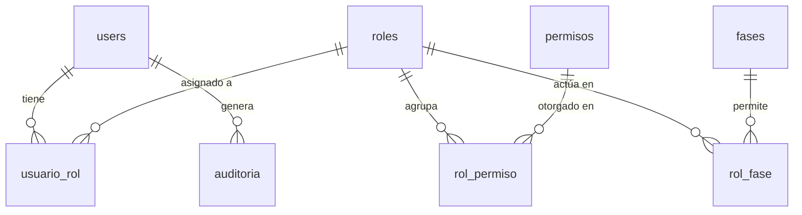
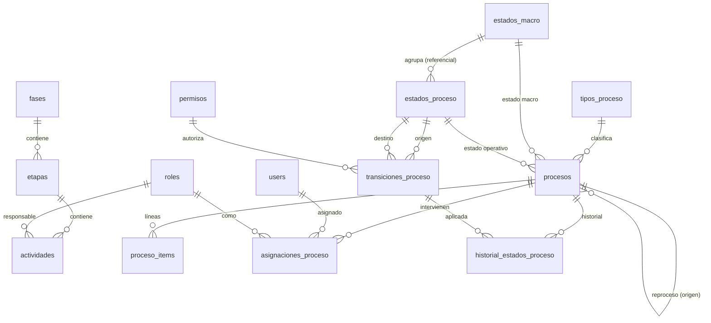
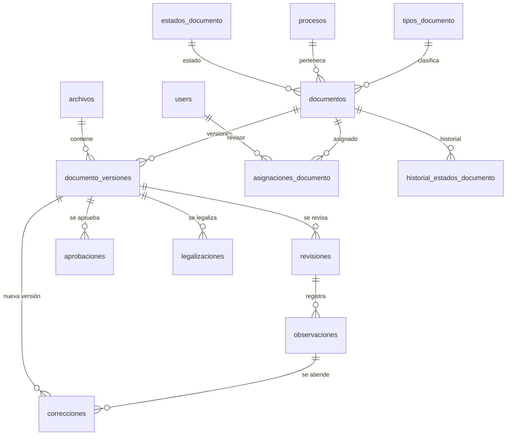
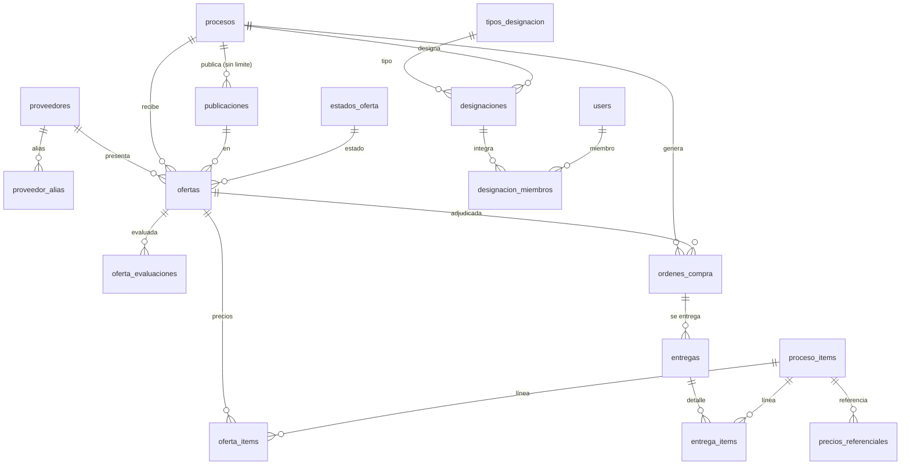

# Entrega A — Arquitectura de datos (Etapa 3)

Sistema de Contratación Pública por Fases — AIL E.P.
Stack verificado: PHP 8.3 · Laravel 13.43 · Filament 4.16 · PostgreSQL 16.

> Estado: **v2, ajustada con tus respuestas**. El script SQL (`database/sql/01_esquema_contratacion.sql`) es ahora la fuente de verdad de columnas y restricciones; este documento explica las decisiones.
> Fuente principal: modelo Bizagi. El Excel es solo referencia de campos.

### Cambios de v2 respecto a v1

| # | Cambio | Motivo |
|---|---|---|
| 1 | Roles: `COMPRAS` se separa en `COMPRAS_JEFE` (recibe y asigna) y `COMPRAS_ANALISTA` (revisa y publica; puede ser otra persona distinta del revisor, por eso las asignaciones son por actividad). Total 10 roles. | Respuesta 7. |
| 2 | Fase Contractual limitada a: orden de compra, entregas (fecha, responsable, cantidades), administrador de contrato y documentos de cierre. El pago y el acta no se modelan como flujo; solo existen como **tipos de documento**. | Respuestas 2 y 6. |
| 3 | Nueva tabla `devoluciones` (memorando, motivo, `reapertura_permitida`). `reabrir` solo procede si la última devolución lo autoriza; si no, solo `cerrar_sin_reapertura`. El analista de Compras ejecuta estas transiciones. | Respuesta 3. |
| 4 | `procesos.proceso_origen_id` desaparece. Reabrir usa **el mismo proceso** con `procesos.ciclo` (+1) y `publicaciones.ciclo`. El código NC puede repetirse entre ciclos. | Respuestas 3 y 4. |
| 5 | `procesos.codigo` es **nullable**: lo asigna Compras antes de publicar (Bizagi: "Asignar responsable y número de proceso"). | Bizagi. |
| 6 | Nueva tabla `transicion_proceso_requisitos`: documentos requeridos por transición (tipo + estado mínimo). Hoy vacía; se llena desde la aplicación cuando definan los obligatorios. | Respuesta 5. |
| 7 | Permiso nuevo `expedientes.descargar` para el formulario de descarga masiva de documentos del proceso (los usuarios autorizados se definirán). | Respuesta 5. |
| 8 | `ofertas.publicacion_id` pasa a obligatorio. `estados_documento.grupo` y `estados_oferta.resultado` permiten reportes sin comparar códigos. | Diseño. |
| 9 | `entregas.responsable_id` (administrador de contrato que registra). | Respuesta 2. |
| 10 | Transiciones de proceso: 19 (se elimina `solicitar_reapertura` desde Cierre y se agrega `cerrar_sin_reapertura`). | Respuesta 3. |

**Total: 49 tablas nuevas**, más `users` y las de Laravel.

---

## 1. Convenciones

| Tema | Regla |
|---|---|
| Nombres | Tablas y columnas en español, minúsculas, `snake_case`, plural en tablas (`proveedores`, `publicaciones`). Sin prefijos de columna. |
| Excepción de framework | `users` (con `email`, `password`) y `created_at` / `updated_at` / `deleted_at` se mantienen por compatibilidad con Laravel. |
| Claves | `id` bigint identidad. Foráneas `<singular>_id`. Usuarios: `user_id`. |
| Fechas | `timestamptz`. Se guardan en UTC y se muestran en `America/Guayaquil`. |
| Dinero y cantidades | `numeric(14,4)` para precios unitarios, `numeric(16,2)` para totales, `integer`/`bigint` para cantidades. |
| Catálogos | Tablas configurables con `codigo` (estable, usado por el código) y `nombre` (editable). El código PHP nunca compara nombres. |
| Inmutabilidad | Tablas históricas son *append-only*: un trigger bloquea `UPDATE` y `DELETE` (ver §9). |
| Estados | Tres ámbitos independientes: **proceso**, **documento**, **oferta**. Cada uno con su catálogo, sus transiciones y su historial. |
| Permisos | `modulo.accion` en minúsculas, p. ej. `documentos.solicitar_correccion`. |

---

## 2. Diagramas entidad-relación

### 2.1 Seguridad

### 2.2 Flujo y procesos

### 2.3 Gestión documental

### 2.4 Proveedores, ofertas y contratación

---

## 3. Diccionario de datos

Notación: **PK**, *FK*, `U` único, `N` nullable. Se omiten `created_at`/`updated_at` salvo en tablas append-only (solo `created_at`).

### 3.1 Seguridad y administración

| Tabla | Columnas | Notas |
|---|---|---|
| `users` | `id`, `name`, `email` U, `password`, `cedula` U N, `cargo` N, `unidad` N, `activo` bool | Ya existe. Se conserva. |
| `roles` | `id`, `codigo` U, `nombre`, `descripcion` N, `es_sistema` bool, `activo` bool | `es_sistema` impide borrar roles base. |
| `permisos` | `id`, `codigo` U, `nombre`, `descripcion` N, `modulo`, `requiere_asignacion` bool, `activo` bool | `requiere_asignacion`: la Policy exige que el registro esté asignado al usuario (ver §7). |
| `rol_permiso` | *rol_id*, *permiso_id* — PK compuesta | |
| `usuario_rol` | *user_id*, *rol_id* — PK compuesta | Un usuario puede tener varios roles. |
| `rol_fase` | *rol_id*, *fase_id* — PK compuesta | Acceso por fase: un rol solo opera en las fases listadas. |
| `parametros` | `id`, `clave` U, `valor`, `tipo`, `descripcion` | Reglas numéricas configurables (§6). |
| `auditoria` | `id`, *user_id* N, `evento`, `entidad`, `entidad_id` N, `valores_anteriores` jsonb N, `valores_nuevos` jsonb N, `ip` N, `agente` N, `created_at` | Append-only. Incluye login, descargas y exportaciones (`evento` = `documento.descargado`, `reporte.exportado`…). |

### 3.2 Configuración de flujo

| Tabla | Columnas | Notas |
|---|---|---|
| `fases` | `id`, `codigo` U, `nombre`, `orden`, `activo` | Preparatoria, Precontractual, Contractual. |
| `estados_macro` | `id`, `codigo` U, `nombre`, `orden`, *fase_id* N | 4 filas: Preparatoria, Precontractual, Contractual, Finalizado. |
| `etapas` | `id`, *fase_id*, `codigo` U, `nombre`, `orden`, `activo` | Agrupan actividades. |
| `actividades` | `id`, *etapa_id*, `codigo` U, `nombre`, `tipo` (`tarea`/`subproceso`/`decision`), `orden`, *rol_id* N, `activo` | Traducción de Bizagi a datos. `rol_id` = carril responsable. |
| `estados_proceso` | `id`, `codigo` U, `nombre`, `orden`, `es_inicial`, `es_final`, `color` N, `activo` | Estados operativos configurables. |
| `transiciones_proceso` | `id`, *estado_origen_id* N, *estado_destino_id*, `codigo`, `nombre`, *estado_macro_destino_id* N, *permiso_id*, `requiere_comentario`, `requiere_documento_aprobado`, `validaciones` jsonb N, `activo` | U(`estado_origen_id`,`codigo`). `estado_origen_id` NULL = creación. `estado_macro_destino_id` NULL = no cambia el macro. |
| `historial_estados_proceso` | `id`, *proceso_id*, *transicion_id*, *estado_origen_id* N, *estado_destino_id*, *estado_macro_id*, *user_id*, `comentario` N, `created_at` | Append-only. |
| `estados_documento` | `id`, `codigo` U, `nombre`, `orden`, `es_inicial`, `es_final`, `activo` | |
| `transiciones_documento` | misma estructura que `transiciones_proceso`, sin macro | |
| `historial_estados_documento` | `id`, *documento_id*, *transicion_id*, origen, destino, *user_id*, `comentario` N, `created_at` | Append-only. |
| `estados_oferta` | `id`, `codigo` U, `nombre`, `orden`, `es_inicial`, `es_final`, `activo` | |
| `transiciones_oferta` | misma estructura | |
| `historial_estados_oferta` | `id`, *oferta_id*, *transicion_id*, origen, destino, *user_id*, `comentario` N, `created_at` | Append-only. |
| `tipos_proceso` | `id`, `codigo` U, `nombre`, `prefijo`, `activo` | Bizagi: "Seleccionar el tipo de proceso (Abastecimiento Centralizado)". |
| `tipos_designacion` | `id`, `codigo` U, `nombre`, `monto_minimo` numeric N, `orden`, `activo` | Reemplaza el `IF` del Excel (col. AD). Umbrales editables. |

### 3.3 Procesos y asignaciones

| Tabla | Columnas | Notas |
|---|---|---|
| `procesos` | `id`, `codigo` U, *tipo_proceso_id*, `objeto_contratacion`, `codigo_cpc` N, *estado_macro_id*, *estado_proceso_id*, `observacion` N, *creado_por* (user_id), `deleted_at` N | `proceso_origen_id`: reproceso/reapertura (006 → 070). |
| `proceso_items` | `id`, *proceso_id*, `numero_linea`, `cum`, `descripcion`, `cantidad` bigint | U(`proceso_id`,`numero_linea`). Líneas de producto. |
| `precios_referenciales` | `id`, *proceso_item_id*, *proveedor_id* N, `fuente`, `precio_unitario` | Excel "PRECIOS MSP" (K, L). `fuente` por confirmar. |
| `asignaciones_proceso` | `id`, *proceso_id*, *user_id*, *rol_id*, *fase_id*, *etapa_id* N, *actividad_id* N, *asignado_por*, `fecha_inicio`, `fecha_fin` N, `activo` | Quién interviene en cada fase/etapa del proceso. Base del control "por responsable". |

### 3.4 Gestión documental

| Tabla | Columnas | Notas |
|---|---|---|
| `tipos_documento` | `id`, `codigo` U, `nombre`, *fase_id* N, *etapa_id* N, *rol_generador_id* N, *rol_revisor_id* N, `requiere_revision`, `requiere_aprobacion`, `requiere_legalizacion`, `extensiones_permitidas`, `tamano_maximo_mb`, `activo` | Configurable sin tocar código. |
| `archivos` | `id`, `disco`, `ruta`, `nombre_original`, `nombre_interno` U, `extension`, `mime`, `tamano_bytes`, `hash_sha256`, *user_id*, `created_at` | Append-only. Sin binarios en BD. |
| `documentos` | `id`, *proceso_id*, *tipo_documento_id*, *etapa_id* N, *estado_documento_id*, *version_actual_id* N, `titulo`, `numero_documento` N, `fecha_documento` N, *oferta_id* N, *designacion_id* N, *creado_por*, `deleted_at` N | `numero_documento` = código institucional (p. ej. memorandos). `oferta_id`/`designacion_id` enlazan documentos a ofertas y designaciones. |
| `documento_versiones` | `id`, *documento_id*, `numero_version`, *archivo_id*, *user_id*, `comentario` N, `created_at` | U(`documento_id`,`numero_version`). Append-only: **nunca se sobrescribe**. |
| `asignaciones_documento` | `id`, *documento_id*, *user_id*, `tarea` (`revisar`/`corregir`), *asignado_por*, `fecha_asignacion`, `fecha_fin` N, `activo` | Base de "solo revisa lo que le asignaron". |
| `revisiones` | `id`, *documento_version_id*, `numero_revision`, *revisor_id* (user), `resultado` (`aprobada`/`con_observaciones`), `fecha_inicio`, `fecha_fin` N, `created_at` | Append-only. |
| `observaciones` | `id`, *revision_id*, `tipo` (`observacion`/`recomendacion`), `texto`, *user_id*, `created_at` | Append-only. |
| `correcciones` | `id`, *observacion_id*, *documento_version_id* (versión que corrige), *user_id*, `descripcion`, `created_at` | Append-only. |
| `aprobaciones` | `id`, *documento_version_id*, *user_id*, `comentario` N, `created_at` | Append-only. |
| `legalizaciones` | `id`, *documento_version_id*, *user_id*, *archivo_id* N (documento firmado), `observacion` N, `created_at` | Append-only. |

### 3.5 Proveedores, ofertas y contratación

| Tabla | Columnas | Notas |
|---|---|---|
| `proveedores` | `id`, `ruc` U N, `razon_social`, `activo`, `deleted_at` N | RUC nullable: el Excel solo tiene nombre hasta la OC. |
| `proveedor_alias` | `id`, *proveedor_id*, `alias` U | Mapea "PEZCAL" ↔ razón social para la importación. |
| `publicaciones` | `id`, *proceso_id*, `secuencia` smallint, `codigo_nc`, `enlace` N, `fecha_publicacion`, `fecha_limite`, `observacion` N | U(`proceso_id`,`secuencia`). Excel AG–AK y AL–AP. `codigo_nc` **no** es único global (006 y 070 lo comparten). |
| `ofertas` | `id`, *proceso_id*, *publicacion_id* N, *proveedor_id*, *estado_oferta_id*, `fecha_presentacion` N, `observacion` N, `deleted_at` N | U(`proceso_id`,`proveedor_id`,`publicacion_id`). Excel M–Z. |
| `oferta_items` | `id`, *oferta_id*, *proceso_item_id*, `precio_unitario` | U(`oferta_id`,`proceso_item_id`). Totales **calculados** en vistas. |
| `oferta_evaluaciones` | `id`, *oferta_id*, *evaluador_id* (user), `cumple` bool, `seleccionada` bool, `motivo` N, `created_at` | Append-only. |
| `designaciones` | `id`, *proceso_id*, *tipo_designacion_id*, `monto_referencia` N, `fecha` N, `observacion` N | Excel AD–AF. Memorandos = filas en `documentos` con `designacion_id`. |
| `designacion_miembros` | `id`, *designacion_id*, *user_id*, *rol_id* | Integrantes de la Comisión / delegado / financiero / jurídico. |
| `ordenes_compra` | `id`, *proceso_id*, *oferta_id*, *proveedor_id*, `numero` N, `fecha_orden`, `representante_legal` N, `administrador_nombre` N, `administrador_correo` N, *administrador_user_id* N | Excel AQ–AV. El administrador puede no ser usuario del sistema. |
| `entregas` | `id`, *orden_compra_id*, `numero_entrega`, `fecha_entrega`, `observacion` N | U(`orden_compra_id`,`numero_entrega`). Excel AW–BD. Normaliza "Entrega 1/2". |
| `entrega_items` | `id`, *entrega_id*, *proceso_item_id*, `cantidad`, `precio_unitario` | Total de entrega calculado. |

**Total: 47 tablas nuevas**, más `users` (existente) y las de Laravel (`sessions`, `cache`, `jobs`, etc.).

---

## 4. Cobertura del Excel (56 columnas)

| Columnas | Destino |
|---|---|
| A (Item) | Descartada: es un contador; el identificador es `procesos.codigo`. |
| B | `procesos.codigo` |
| C | `procesos.codigo_cpc` |
| D | `procesos.objeto_contratacion` |
| E | `proceso_items.descripcion` |
| F | `proceso_items.cum` |
| G | `proceso_items.cantidad` |
| H | `estados_proceso` (mapeo en §5) |
| I | `asignaciones_proceso` (rol analista responsable) |
| J | Descartada (el N.º de pedido no se necesita) |
| K, L | `precios_referenciales` |
| M–Z | `ofertas`, `oferta_items`, `proveedores`, `proveedor_alias` |
| O, P, S, T, W, X, AA, AB | Calculados en vistas (no se almacenan) |
| AC | Regla: `parametros.minimo_proformas` |
| AD | `tipos_designacion` + `designaciones` |
| AE, AF | `documentos.numero_documento` (memorandos) con `designacion_id` |
| AG–AJ, AL–AO | `publicaciones` (1..n por ciclo, sin límite) |
| AK, AP | Calculados: conteo de `ofertas` por publicación |
| AQ–AV | `ordenes_compra` |
| AW–BC | `entregas`, `entrega_items` |
| BD | `procesos.observacion` / `ordenes_compra` (por confirmar) |

---

## 5. Catálogo de estados (referencial, configurable)

### 5.1 Estados macro

`PREPARATORIA` · `PRECONTRACTUAL` · `CONTRACTUAL` · `FINALIZADO`

El macro **no se deduce del estado operativo**: cambia solo cuando una transición lo indica (`estado_macro_destino_id`). Esto resuelve que "En revisión" y "En corrección" ocurren en dos fases: la revisión del expediente la hace Compras (carril Precontractual en Bizagi) sobre un expediente generado en Preparatoria.

### 5.2 Estados operativos de proceso

| Orden | Código | Nombre | Inicial | Final |
|---|---|---|---|---|
| 1 | `INICIO` | Inicio | ✔ | |
| 2 | `EN_REVISION` | En revisión | | |
| 3 | `EN_CORRECCION` | En corrección | | |
| 4 | `PARA_LEGALIZAR` | Para legalizar | | |
| 5 | `PARA_PUBLICAR` | Para publicar | | |
| 6 | `PUBLICADO` | Publicado | | |
| 7 | `PARA_COMISION` | Para Comisión | | |
| 8 | `EN_COMISION` | En comisión | | |
| 9 | `APROBADO` | Aprobado | | |
| 10 | `GENERACION_EXPEDIENTE` | Generación de Expediente | | |
| 11 | `GENERACION_ORDEN_COMPRA` | Generación de Orden de Compra | | |
| 12 | `ADMINISTRACION_CONTRATO` | Administración de Contrato | | |
| 13 | `CIERRE` | Cierre | | ✔ |
| 14 | `PARA_REAPERTURA` | Para reapertura | | |

Mapeo del Excel: `EN PROCESO` → según avance real del proceso; `PROCESO DEVUELTO` → `PARA_REAPERTURA`.

### 5.3 Transiciones de proceso (semilla inicial)

| # | Origen → Destino | Código | Permiso | Macro destino | Origen en Bizagi / validación |
|---|---|---|---|---|---|
| 1 | ∅ → INICIO | `crear` | `procesos.crear` | Preparatoria | Evento inicio + "Seleccionar tipo de proceso". |
| 2 | INICIO → EN_REVISION | `enviar_a_revision` | `procesos.enviar_a_revision` | — | Genera expediente preparatorio. Exige documentos del expediente cargados. |
| 3 | EN_REVISION → EN_CORRECCION | `solicitar_correcciones` | `documentos.solicitar_correccion` | — | Se rotula "Remitir observaciones". Comentario opcional. |
| 4 | EN_CORRECCION → EN_REVISION | `reenviar_a_revision` | `procesos.enviar_a_revision` | — | Ciclo de corrección. Exige nueva versión de documentos observados. |
| 5 | EN_REVISION → PARA_LEGALIZAR | `validar_documentacion` | `documentos.aprobar` | — | "¿Correcto y completo?" = sí. Sin observaciones pendientes. |
| 6 | PARA_LEGALIZAR → PARA_PUBLICAR | `autorizar_publicacion` | `procesos.autorizar_transicion` | (sin cambio: sigue Preparatoria) | "Solicitar publicación". Documentos legalizados. |
| 7 | PARA_PUBLICAR → PUBLICADO | `publicar` | `publicaciones.registrar` | — | Exige responsable asignado y publicación registrada (NC). |
| 8 | PUBLICADO → PUBLICADO | `republicar` | `publicaciones.registrar` | — | Decisión `republicar` (ver §24): total de ofertas del ciclo < mínimo y quedan publicaciones por hacer. |
| 9 | PUBLICADO → PARA_DOCUMENTACION | `remitir_ofertas` | `procesos.autorizar_transicion` | — | Decisión `remitir` (ver §24). Reemplaza a `enviar_a_comision`. |
| 10 | PUBLICADO → PARA_REAPERTURA | `devolver_expediente` | `procesos.autorizar_transicion` | — | Decisión `devolver` (publicaciones agotadas y 0 ofertas) con Memorando e Informe de devolución legalizados (ver §24). |
| 11 | PARA_COMISION → EN_COMISION | `iniciar_comision` | `designaciones.registrar` | — | Designación registrada (tipo según monto). |
| 12 | EN_COMISION → APROBADO | `aprobar_seleccion` | `ofertas.seleccionar` | — | Oferta seleccionada y informe aprobado. |
| 13 | EN_COMISION → PARA_REAPERTURA | `recomendar_devolucion` | `ofertas.evaluar` | — | "No existe proforma seleccionable". |
| 14 | APROBADO → GENERACION_EXPEDIENTE | `generar_expediente` | `procesos.autorizar_transicion` | — | Consolidación de documentación habilitante. |
| 15 | GENERACION_EXPEDIENTE → GENERACION_ORDEN_COMPRA | `generar_orden_compra` | `ordenes_compra.registrar` | — | Reasigna expediente para OC. |
| 16 | GENERACION_ORDEN_COMPRA → ADMINISTRACION_CONTRATO | `iniciar_administracion` | `ordenes_compra.registrar` | Contractual | OC registrada y administrador asignado. |
| 17 | ADMINISTRACION_CONTRATO → CIERRE | `cerrar` | `procesos.cerrar` | Finalizado | Entregas y acta registradas. |
| 18 | CIERRE → PARA_REAPERTURA | `solicitar_reapertura` | `procesos.reabrir` | — | Comentario obligatorio. |
| 19 | PARA_REAPERTURA → INICIO | `reabrir` | `procesos.reabrir` | Preparatoria | Ver pregunta 3. |

Las validaciones de la columna final se guardan como reglas declarativas en `transiciones_proceso.validaciones` (jsonb), p. ej. `{"minimo_ofertas": "parametro:minimo_proformas"}`. Cambiar un flujo es editar filas, no código.

### 5.4 Estados de documento

`BORRADOR` → `PENDIENTE_REVISION` → `EN_REVISION` → (`CON_OBSERVACIONES` → `EN_CORRECCION` → `PENDIENTE_REVISION`)* → `APROBADO` → `LEGALIZADO` · `ANULADO`

Transiciones: `cargar_version`, `asignar_revisor`, `iniciar_revision`, `registrar_observaciones`, `cargar_correccion`, `aprobar`, `legalizar`, `anular`. Se repite el ciclo tantas veces como haga falta; cada vuelta crea una `revision` y una `documento_version` nuevas.

### 5.5 Estados de oferta

`RECIBIDA` → `EN_EVALUACION` → `ACLARACION_SOLICITADA` → `SELECCIONABLE` / `NO_SELECCIONABLE` → `SELECCIONADA` → `ADJUDICADA`

---

## 6. Parámetros iniciales (`parametros`)

| Clave | Valor | Origen |
|---|---|---|
| `minimo_proformas` | 3 | Excel AC. Bizagi: "número de ofertas solicitado". |
| `tamano_maximo_documento_mb` | 20 | Propuesto. |

Umbrales de designación (100.000 y 500.000) viven en `tipos_designacion.monto_minimo`: `DELEGADO` (0), `COMISION` (100.000), `COMISION_FINANCIERO_JURIDICO` (500.000).

---

## 7. Roles y matriz de permisos

### 7.1 Roles iniciales (referenciales)

`ADMIN` Administrador del sistema · `UNIDAD_REQUIRENTE` · `COMPRAS` · `COMISION_TECNICA` · `ADMIN_CONTRATO` · `CONSULTA`

Derivados de los carriles de Bizagi (Unidad Requirente, Compras, Comisión Técnica) y de la columna AD del Excel (delegado, financiero, jurídico). Son ajustables.

### 7.2 Autorización: tres capas

1. **Permiso por rol** (`rol_permiso`): ¿puede hacer esta acción?
2. **Fase** (`rol_fase`): ¿su rol opera en esta fase?
3. **Asignación**: si `permisos.requiere_asignacion = true`, la Policy exige una fila activa en `asignaciones_proceso` o `asignaciones_documento` para ese usuario y registro.

Ejemplo: `documentos.revisar` tiene `requiere_asignacion = true`. Un usuario con ese permiso solo revisa documentos que le asignaron.

El **acceso a un módulo** es el permiso `*.ver`. La **ejecución de acciones** son permisos distintos (`documentos.aprobar`, etc.).

### 7.3 Catálogo de permisos

| Módulo | Permisos | Con asignación |
|---|---|---|
| `usuarios` | `ver`, `crear`, `editar`, `eliminar` | |
| `roles` | `ver`, `crear`, `editar`, `eliminar` | |
| `permisos` | `ver` | |
| `catalogos` | `ver`, `editar` | |
| `flujos` | `ver`, `editar` | |
| `parametros` | `ver`, `editar` | |
| `auditoria` | `ver` | |
| `procesos` | `ver`, `crear`, `editar`, `asignar_responsables`, `enviar_a_revision`, `autorizar_transicion`, `cerrar`, `reabrir` | `editar`, `enviar_a_revision` |
| `documentos` | `ver`, `subir`, `descargar`, `revisar`, `aprobar`, `solicitar_correccion`, `corregir`, `legalizar`, `asignar_revisor`, `anular` | `revisar`, `aprobar`, `solicitar_correccion`, `corregir` |
| `publicaciones` | `ver`, `registrar`, `editar` | |
| `proveedores` | `ver`, `crear`, `editar` | |
| `ofertas` | `ver`, `registrar`, `editar`, `evaluar`, `seleccionar` | `evaluar`, `seleccionar` |
| `designaciones` | `ver`, `registrar` | |
| `ordenes_compra` | `ver`, `registrar` | |
| `entregas` | `ver`, `registrar` | `registrar` |
| `reportes` | `ver`, `exportar` | |

### 7.4 Matriz por rol (propuesta inicial)

V = ver · C = crear/registrar · E = editar · A = acciones de flujo (aprobar, autorizar…) · X = exportar

| Módulo | ADMIN | UNIDAD_REQ. | COMPRAS | COMISION / AFIN | FINANC. / JURID. | ADMIN_CONTRATO | CONSULTA |
|---|---|---|---|---|---|---|---|
| Administración (usuarios, roles, catálogos, flujos, parámetros) | V C E | — | — | — | — | — | — |
| Auditoría | V | — | — | — | — | — | V |
| Procesos | V C E A | V C E | V E A | V | V | V | V |
| Documentos: subir/descargar | V C | V C (propios) | V C | V C | V | V C | V |
| Documentos: revisar/aprobar/solicitar corrección | — | — | A (asignados) | A (asignados) | A (asignados) | — | — |
| Documentos: corregir/legalizar | — | C (asignados) | A | — | A (jurídico) | — | — |
| Publicaciones | V | V | V C E | V | — | — | V |
| Proveedores | V C E | V | V C E | V | — | V | V |
| Ofertas: registrar | — | — | V C E | V | — | — | V |
| Ofertas: evaluar/seleccionar | — | — | — | A (asignados) | — | — | — |
| Designaciones | V | — | V C | V | V | — | V |
| Órdenes de compra / entregas | V | — | V C | — | — | V C E | V |
| Reportes | V X | V | V X | V | V | V | V X |

El `ADMIN` gestiona el sistema, no ejecuta decisiones de contratación. Es una decisión consciente para separar funciones; ajustable.

---

## 8. Estrategia de almacenamiento documental

- Disco Laravel dedicado `documentos` (privado), configurable por `.env` (`DOCUMENTOS_DISCO`), raíz `storage/app/private/documentos` (ya persistente por el volumen `docs_data`).
- Ruta: `procesos/{proceso_id}/{fase}/{etapa}/{tipo_documento}/{uuid}.{ext}` (se usa el `id` porque el código del proceso se asigna después)
- Nombre interno = UUID. El nombre original se conserva solo en BD.
- Validación: extensión y MIME contra `tipos_documento.extensiones_permitidas`, tamaño contra `tamano_maximo_mb`, hash SHA-256 para detectar duplicados e integridad.
- Descarga: controlador con autorización (`documentos.descargar` + fase + asignación) y registro en `auditoria`. Sin enlaces públicos.
- Cambiar a S3 o a un servidor documental = cambiar `archivos.disco`; las relaciones no cambian.

---

## 9. Integridad y trazabilidad

- **Append-only** (trigger `UPDATE`/`DELETE` → excepción): `historial_estados_*`, `auditoria`, `archivos`, `documento_versiones`, `revisiones`, `observaciones`, `correcciones`, `aprobaciones`, `legalizaciones`, `oferta_evaluaciones`.
- **Integridad referencial**: todas las FK con `ON DELETE RESTRICT`. Los registros de negocio se anulan o se marcan (`deleted_at`), no se borran.
- **Consistencia**: `documentos.version_actual_id` debe pertenecer al mismo documento (FK compuesta). `estado_proceso`/`estado_macro` solo cambian a través de la transición (función SQL `aplicar_transicion_proceso`, que también inserta el historial).
- **Índices**: FK, `procesos(estado_proceso_id)`, `procesos(estado_macro_id)`, `asignaciones_proceso(user_id, activo)`, `documentos(proceso_id, estado_documento_id)`, `auditoria(entidad, entidad_id)`, `proveedores(ruc)`.

## 10. Vistas de reportes (se definen en la Entrega B)

`v_matriz_contratacion` (equivalente al Excel) · `v_procesos_por_fase` · `v_procesos_por_estado` · `v_procesos_por_responsable` · `v_ofertas_por_proceso` · `v_ofertas_por_proveedor` · `v_documentos` · `v_documentos_pendientes` · `v_documentos_en_correccion` · `v_documentos_aprobados` · `v_historial_revisiones` · `v_historial_observaciones` · `v_historial_correcciones` · `v_tiempos_revision`

Los reportes de procesos publicados, en comisión, aprobados, contractuales y finalizados son filtros de `v_procesos_por_estado`. La exportación a Excel/CSV respeta `reportes.exportar` y las asignaciones del usuario.

---

## 11. Decisiones resueltas y pendientes

**Ajuste de Entrega C a la matriz de permisos:** el patrón `%.ver` ya no concede los módulos de administración (`usuarios`, `roles`, `permisos`, `catalogos`, `flujos`, `parametros`, `auditoria`) a roles distintos de `ADMIN`. Las fechas se guardan en UTC (`timestamptz`) y el panel las muestra en `America/Guayaquil`.

**Resueltas con tus respuestas:** el macro cambia por transición; la fase Contractual empieza al recibir la orden de compra; la reapertura reutiliza el mismo proceso y depende del memorando de devolución; el NC puede repetirse al reabrir; los tipos de documento son una tabla editable con requisitos configurables; el pago queda fuera; Compras se divide en jefe y analista.

**Pendientes (no bloquean el esquema):**
1. **Resuelta (Entrega C):** `expedientes.descargar` queda para `COMPRAS_ANALISTA`, `UNIDAD_REQUIRENTE` y `ADMIN_CONTRATO`. Pendiente: qué tipos de documento ve cada rol dentro del expediente (unos son para la unidad requirente, otros para Compras y todos para el administrador de contrato). Se resolverá con una tabla `tipo_documento_rol` cuando se definan los tipos de documento; mientras tanto el permiso es por rol, no por tipo.
2. En la descarga del expediente, ¿se incluye solo la última versión de cada documento o también las anteriores? Propuesta: última versión por defecto, con opción de incluir todas.
3. Actividades sin carril claro en Bizagi (`rol` vacío en el script): consolidación de la documentación, solicitar designación, designar y convocar, reasignar expediente para orden de compra y recibir orden de compra.
4. ¿El `ADMIN` también debe poder ver documentos? Hoy tiene `documentos.ver` pero no `descargar`.

---

## 12. Visibilidad de procesos (Entrega D1)

Capa 3 de autorización (asignación al registro), implementada en `Proceso::scopeVisiblesPara()`:

| Rol | Procesos que ve |
|---|---|
| `COMPRAS_JEFE` | Todos |
| `COMPRAS_ANALISTA` | Solo donde tiene una asignación activa (`asignaciones_proceso`) |
| `UNIDAD_REQUIRENTE` | Los que creó y su documentación |
| `ADMIN`, `CONSULTA` | Todos (supuesto, por sus funciones de administración y consulta) |
| Comisión, Administrador de contrato | Solo donde tienen una asignación activa (supuesto) |

Al crear un proceso, quien lo crea queda asignado como `UNIDAD_REQUIRENTE` en la fase Preparatoria; así puede ejercer permisos que exigen asignación (p. ej. enviar a revisión).
Los datos del proceso solo se editan en los estados `INICIO` y `EN_CORRECCION` (supuesto, constante `Proceso::ESTADOS_EDITABLES`).

---

## 13. Código del proceso (Entrega D, correcciones)

Formato: `<prefijo del tipo>-<prefijo institucional>-<año>-<número>`, p. ej. `PE-AILEP-2026-001`.

| Pieza | Dónde se configura |
|---|---|
| `PE` | `tipos_proceso.prefijo` (uno por tipo de proceso) |
| `AILEP` | `parametros.prefijo_institucion` |
| Año | El del momento de generar el código, en la zona horaria `parametros.zona_horaria` (`America/Guayaquil`) |
| Número | Contador en `secuencias_codigo_proceso` por tipo de proceso y año; reinicia en 001 cada año. Dígitos: `parametros.digitos_codigo_proceso` (3) |

- Lo genera el analista de Compras asignado con la función `asignar_codigo_proceso(proceso_id, user_id)` (permiso `procesos.asignar_codigo`, exige asignación), solo en estados con `estados_proceso.permite_asignar_codigo` (hoy `PARA_PUBLICAR`: documentos aprobados y legalizados, publicación solicitada).
- La transición `publicar` exige que el proceso ya tenga código (regla `requiere_codigo`).
- El código no se puede escribir ni cambiar a mano (trigger); al reabrir el proceso se conserva. La asignación queda en `auditoria`.
- Se eliminan `procesos.anio` y `procesos.numero_pedido`. Las vistas calculan `anio_creacion` desde `created_at`.

---

## 14. Documentos requeridos y publicaciones (Entrega D2, definiciones)

- **Enviar a revisión** (`enviar_a_revision` y `reenviar_a_revision`) exige dos documentos con al menos una versión cargada (archivo): **Informe de necesidad** y **Especificaciones técnicas**. Son documentos distintos y siguen el mismo flujo: revisión, aprobación y legalización. La legalización consiste en subir el PDF con firma electrónica. Los requisitos están en `transicion_proceso_requisitos` y se editan como dato. Los demás documentos del gráfico de Bizagi se incorporarán al avanzar en los flujos.
- **Publicaciones:** no hay límite por ciclo (se elimina el parámetro `maximo_publicaciones`). Un proceso se republica mientras las ofertas sean menos que `minimo_proformas`.
- **Pendiente (se retomará antes de la fase contractual):** si el proceso solo puede reabrirse dentro del año en curso y pasar a "Finalizado" al cambiar el año.

---

## 15. Acciones sobre el proceso (Entrega D2)

En el detalle del proceso (`/admin/procesos/{id}`) el usuario ve solo los botones que le corresponden:

| Botón | Quién lo ve | Regla |
|---|---|---|
| Transiciones del flujo (Enviar a revisión, Remitir observaciones, Validar documentación, Autorizar publicación…) | Quien tiene el permiso de la transición, opera en la fase actual con su rol y, si el permiso lo exige, está asignado al proceso | Se ejecuta con `aplicar_transicion_proceso()`. Si la transición exige comentario, el formulario lo pide. Los errores de la base (documentos faltantes, observaciones pendientes, etc.) se muestran tal cual. |
| Generar código del proceso | Analista asignado, con `procesos.asignar_codigo` | Solo si el proceso no tiene código y está en un estado con `permite_asignar_codigo`. |
| Asignar analista | Jefe de Compras (`procesos.asignar_responsables`), solo después de que la unidad requirente envíe el proceso a revisión (estados que no son inicial ni final) | Elige un analista activo. Hay un único analista responsable por proceso: asignar a otro reemplaza al actual. Queda en `auditoria` (`proceso.analista_asignado`). |

La lógica está en `App\Services\ServicioProceso`; las pantallas solo la invocan. Las transiciones que dependen de módulos aún no construidos (publicaciones, ofertas, designaciones, órdenes de compra) aparecen con su permiso, pero la base responde con el requisito que falta hasta que existan esos módulos.

## 16. Documentos (Etapa 7 - Entrega E1)

- Los archivos se guardan en el disco privado `documentos` (`storage/app/private/documentos`), nunca con URL publica.
  Ruta final: `procesos/{proceso}/documentos/{documento}/{uuid}.{ext}`; el nombre original solo vive en `archivos`.
- Formatos: PDF, Word y Excel (`tipos_documento.extensiones_permitidas`, por defecto `pdf,doc,docx,xls,xlsx`).
  La version legalizada (E2) debe ser PDF. Los PDF se verifican por su cabecera `%PDF-`.
- Tamano maximo: el menor entre el parametro `tamano_maximo_documento_mb` (20) y `tipos_documento.tamano_maximo_mb`.
  `docker/php/uploads.ini` sube los limites de PHP a 25 MB para que el parametro sea el que decida.
- Cada carga crea un documento en BORRADOR con su version 1; cada nueva version la numera la BD (`fn_numerar_version`)
  y pasa a ser la vigente. Solo se agregan versiones en BORRADOR o EN_CORRECCION.
- Quien carga: la unidad requirente mientras el proceso es editable (INICIO / EN_CORRECCION); despues, solo el
  analista asignado. Tipos disponibles: los de la fase actual cuyo rol generador tiene el usuario.
- Al aplicar `enviar_a_revision` o `reenviar_a_revision` al proceso, en la misma transaccion los documentos en
  BORRADOR (con version y que exigen revision) pasan a PENDIENTE_REVISION (`aplicar_transicion_documento`).
- Descarga: ruta `documentos.descargar`, exige `documentos.descargar` y que el proceso sea visible para el usuario;
  siempre como adjunto y con evento `documento.descargado` en `auditoria`.
- Pendiente (E2): asignar revisor, observaciones, correcciones, aprobacion y legalizacion (PDF firmado).

## 17. Ajustes a documentos (Entrega E1.1)

- **Un documento por tipo y proceso.** El trigger `documentos_unico_por_tipo` rechaza un segundo documento vigente (no anulado) del mismo tipo salvo que `tipos_documento.permite_multiples` sea `true` (memorando de solicitud de publicacion, documentacion complementaria, proformas, solicitud de pago, otros). Las correcciones son versiones del mismo documento; al legalizar (E2) el PDF firmado quedara como la version legalizada del mismo registro.
- **Descarga.** Solo la ultima version (la vigente) se descarga; las anteriores se listan en "Versiones" como registro de respaldo.
- **Quien sube versiones.**
  - Unidad requirente: documento en BORRADOR, CON_OBSERVACIONES o EN_CORRECCION y proceso editable.
  - Analista de Compras asignado: documento en PENDIENTE_REVISION, EN_REVISION, CON_OBSERVACIONES o EN_CORRECCION; el estado del documento se conserva. La accion se rotula "Subir documento" para el analista y "Nueva version" para la unidad.
- **Analista y proceso.** El analista ya no tiene `procesos.editar`: no modifica los datos del proceso ni sus items (solo la unidad requirente). Ve los documentos al abrir el proceso ("Ver").
- **Reenvio.** La transicion `reenviar_a_revision` se rotula "Enviar a revision". Al aplicarla, los documentos CON_OBSERVACIONES / EN_CORRECCION vuelven a PENDIENTE_REVISION (la asignacion de correccion se crea y cierra automaticamente hasta que E2 registre observaciones con su propio flujo).
- **Tipo nuevo.** `MEMORANDO_SOLICITUD_PUBLICACION` (PREPARATORIA, rol generador UNIDAD_REQUIRENTE, solo PDF, admite varios: uno por cada solicitud de publicacion).
- **Administracion (solo ADMIN, grupo "Administracion").**
  - `Tipos de documento` (`/admin/tipos-documento`, permiso `catalogos.editar`): crear/editar tipos, formatos, tamano, roles, flujo. No se eliminan, se desactivan.
  - `Documentos obligatorios` (`/admin/documentos-obligatorios`, permiso `flujos.editar`): que documentos exige cada transicion del proceso (tabla `transicion_proceso_requisitos`). La BD los valida en `aplicar_transicion_proceso()`.
  - Las politicas exigen `*.editar` incluso para listar, porque otros roles tienen `catalogos.ver` / `flujos.ver`.
- **Pendiente para E2:** revision, observaciones, validacion ("Para legalizar"), legalizacion con PDF firmado, solicitud de publicacion (numero de memorando manual y horas de cada publicacion) y la reasignacion del analista antes de autorizar la publicacion.

## 18. Revision y validacion de la documentacion (Entrega E2a)

Las acciones del proceso arrastran a sus documentos en la misma transaccion (`ServicioProceso::aplicarTransicion` + `ServicioDocumento`):

| Accion del proceso | Quien | Efecto en los documentos |
|---|---|---|
| Enviar / Reenviar a revision | Unidad requirente | BORRADOR -> PENDIENTE_REVISION. En el reenvio, los documentos CON_OBSERVACIONES exigen una version posterior a la observada; se registra la `correccion` y vuelven a PENDIENTE_REVISION. |
| Remitir observaciones (`solicitar_correcciones`) | Analista asignado | Elige los documentos que la unidad debe corregir (por defecto todos los que estan en revision); los no marcados se consideran correctos y siguen en revision. Por cada elegido se crea `revisiones` (con_observaciones) + `observaciones` y pasa a CON_OBSERVACIONES; la unidad debe cargar una version nueva de cada uno para reenviar. El comentario es opcional; sin el se registra un texto generico. |
| Validar documentacion | Analista asignado | Los documentos en revision pasan a APROBADO (`revisiones` aprobada + `aprobaciones`). El proceso pasa a PARA_LEGALIZAR. La regla `sin_observaciones_pendientes` impide validar con observaciones sin corregir. |

- Las asignaciones de documento (`revisar` / `corregir`) que exige la BD se crean y se cierran automaticamente por el servicio.
- **Reasignacion antes de autorizar la publicacion.** `asignaciones_proceso.desde_historial_id` (lo fija un trigger) indica en que punto del historial de estados se hizo la asignacion. La regla `asignacion_desde_estado_actual` de `autorizar_publicacion` exige una asignacion del analista posterior a la entrada del proceso en PARA_LEGALIZAR. Tras validar, el analista conserva el acceso de consulta, pero la accion "Autorizar publicacion" aparece solo cuando el Jefe de Compras lo asigna de nuevo (el mismo u otro). Reasignar al mismo analista en la misma etapa no duplica la asignacion.
- En PARA_LEGALIZAR el analista no puede subir versiones (los documentos estan APROBADOS) ni editar el proceso.
- La legalizacion y la solicitud de publicacion se describen en la seccion 19 (E2b).

### Ajustes posteriores a E2a

- Con el proceso EN_CORRECCION solo la unidad requirente carga versiones; el analista no (tampoco con el proceso editable).
- Al cargar un documento o una version desde la seccion Documentos se recarga la pagina del proceso, para que los botones superiores ("Enviar a revision", "Editar") se recalculen al instante.

## 19. Legalizacion y solicitud de publicacion (Entrega E2b)

En PARA_LEGALIZAR la unidad requirente ve **"Remitir documentos legalizados"**, un unico formulario con:
los PDF firmados electronicamente de cada documento que exige legalizacion (Informe de necesidad y Especificaciones tecnicas), el memorando de solicitud de publicacion (PDF), el **numero del memorando** (manual) y el **numero de publicaciones** con la **duracion en HORAS de cada una** (24 h = 1 dia). Maximo 5 publicaciones, 1 a 8760 horas cada una.

**Tablas nuevas**
- `solicitudes_publicacion`: una por remision (`ciclo` lo fija un trigger), `numero_memorando`, `memorando_documento_id`, `estado` (`remitida` | `devuelta`), quien y cuando remitio / devolvio y el motivo. Indice unico parcial: solo una `remitida` por proceso.
- `solicitud_publicacion_detalle`: `numero_publicacion` y `horas`. La cantidad de filas es el tope que se valida en la fase contractual ("el numero de publicacion es menor o igual al solicitado").
- `legalizaciones` (ya existia) guarda el PDF firmado (`archivo_id`) sobre la version vigente del documento.

**Transiciones y reglas**
- `remitir_legalizados` (PARA_LEGALIZAR -> PARA_LEGALIZAR, `procesos.remitir_legalizados`, unidad requirente asignada). Reglas `requiere_documentos_legalizados` y `requiere_solicitud_publicacion`. Es una auto-transicion: escribe un movimiento de historial que invalida la asignacion previa del analista, por lo que el Jefe debe asignarlo de nuevo.
- `devolver_legalizacion` (mismo estado, `procesos.devolver_legalizacion`, Jefe y analista, comentario obligatorio): la solicitud queda `devuelta` y los documentos vuelven de LEGALIZADO a APROBADO (transicion de documento `devolver_legalizacion`) para que la unidad cargue de nuevo la documentacion. El analista solo la ve cuando el Jefe lo asigno de nuevo en la etapa (regla de pantalla en `ServicioProceso`).
- `autorizar_publicacion` ahora exige documentos legalizados + solicitud remitida + reasignacion del analista.
- Las acciones `devolver_legalizacion` y `autorizar_publicacion` se ocultan mientras no exista una solicitud remitida; `remitir_legalizados` se oculta cuando ya existe una.

**Servicios**: `ServicioLegalizacion::remitir()` ejecuta todo en una transaccion (legaliza, crea el memorando como documento, registra solicitud y horas, aplica la transicion) y, si algo falla, no queda nada a medias ni archivos huerfanos. Solo la ultima version legalizada se descarga (`documentos.descargar_legalizado`); las anteriores quedan como respaldo.

**Nueva ronda (re-publicacion)**: el Informe y las Especificaciones siguen LEGALIZADOS y no se piden de nuevo; se registra un nuevo memorando y sus datos (nueva solicitud con otro ciclo). La reapertura se construye en una entrega posterior.

**Supuestos**: tope de 5 publicaciones en el formulario; el memorando de una solicitud devuelta queda como historial (la nueva remision crea otro); el Expediente preparatorio ya no exige legalizacion.

## 20. Ajustes posteriores a E2b (E2c)

- **Nombres:** `procesos.descripcion_producto` -> `procesos.objeto_contratacion` ("Objeto de contratacion") y `proceso_items.detalle` -> `proceso_items.descripcion` ("Descripcion"), en esquema, vistas, codigo y pruebas.
- **Flujo de publicacion:** la unidad remite (el proceso sigue en Para legalizar) y el Jefe asigna al analista; al asignarlo, el proceso pasa **solo** a *Para publicar* y se genera el numero `PE-AILEP-AAAA-NNN` (`ServicioProceso::publicarAlAsignar`). "Autorizar publicacion" deja de ser un boton; la transicion sigue existiendo y queda registrada a nombre del analista con el comentario "Automatico: ...". Si el proceso ya tiene numero (reproceso por devolucion), se conserva.
- **Devolver:** `devolver_legalizacion` (Para legalizar, Jefe/analista reasignado) y `devolver_publicacion` (Para publicar -> Para legalizar, Jefe/analista, comentario obligatorio). Ambas dejan la solicitud `devuelta` y los documentos legalizados vuelven a APROBADO.
- **Documentos que acompanan al memorando** (nuevos tipos, PDF, varios por tipo, sin revision): Fichas tecnicas, Certificado de no catalogado, Validacion de firmas electronicas, Autorizacion del requerimiento. Se cargan en el mismo formulario de "Remitir documentos legalizados" (solo los que el proceso aun no tiene) y son *Documentos obligatorios* de la transicion `remitir_legalizados` (editables por el administrador); si falta alguno la base informa cuales.
- Maximo 5 publicaciones en el formulario.

## 21. Flujo de legalizacion y devolucion (Entrega E2d)

Estados nuevos: **LEGALIZADO** y **PARA_REVISION**. Flujo:

1. `PARA_LEGALIZAR` -> la unidad pulsa **Remitir documentos legalizados** (`remitir_legalizados`) -> `LEGALIZADO`.
2. El Jefe asigna al analista -> pasa solo a `PARA_PUBLICAR` (`autorizar_publicacion`, automatica) y se genera el numero `PE-AILEP-AAAA-NNN`.
3. **Devolver a la unidad requirente** (`devolver_legalizacion` desde LEGALIZADO por el Jefe; `devolver_publicacion` desde PARA_PUBLICAR por Jefe o analista; comentario obligatorio) -> `PARA_REVISION`.
4. En `PARA_REVISION` la unidad solo puede cargar, versionar o eliminar documentos de los tipos con `tipos_documento.editable_tras_devolucion` (por defecto Fichas tecnicas, Certificado de no catalogado y Autorizacion del requerimiento; el administrador lo configura en *Tipos de documento*). No modifica el proceso, los items, los PDF legalizados, el memorando ni los datos de la solicitud.
5. La unidad pulsa **Remitir** (`remitir_correccion`) -> `LEGALIZADO`; la base vuelve a exigir los documentos obligatorios. El numero del proceso se conserva y no se pide un memorando nuevo.

La solicitud de publicacion (memorando y horas) permanece `remitida` durante las devoluciones. El tipo "Expediente preparatorio" se elimino del catalogo de tipos de documento.

## 22. Documentos fijos, expediente de publicación y publicación (Entrega E3)

**Documentos fijos por tipo de proceso** (`documentos_fijos`, `documentos_fijos_versiones`): Reglamento Interno (PDF), Proyecto Orden de Compra (Word), Anexo Vinculaciones (Word) y Anexo I Formulario Perfil Integridad Proveedor (Word, **plantilla**). El administrador (permiso `catalogos.editar`) los reemplaza en *Administración → Documentos fijos del proceso → Editar → Nuevo archivo*. Cada reemplazo crea una versión nueva (el archivo anterior queda como respaldo y se puede descargar desde el historial). La plantilla debe conservar `{{objeto_contratacion}}` y `{{numero_proceso}}`; si falta alguno el sistema rechaza el archivo. `migrate:fresh --seed` carga los archivos iniciales (`database/seeders/documentos_fijos/`) con `DocumentosFijosSeeder`, sin pisar lo que el administrador ya haya reemplazado.

**Visibilidad**: los ven el Jefe y el analista de Compras (permiso `expedientes.generar_publicacion`) cuando el proceso está en *Legalizado*, *Para publicar* o posterior; no la unidad requirente y no mientras el proceso está devuelto (*Para revisión*). En la pantalla del proceso, botón *Documentos fijos*; la plantilla se descarga en Word con el objeto de contratación y el número del proceso.

**Generar Expediente Publicación** (`ServicioExpedientePublicacion`): botón junto a *Subir documento*. Lista los documentos vigentes del proceso (el PDF legalizado si lo tienen) y los fijos; vienen marcados todos salvo *Validación de firmas electrónicas* y *Autorización del requerimiento*. Descarga un `.zip` numerado.

**Publicación** (`ServicioPublicacion`, tabla `publicaciones`): el analista asignado, en *Para publicar*, pulsa *Publicar* y registra Necesidad de Contratación Publicación (obligatoria, hasta 60 caracteres; es el código de la necesidad, `publicaciones.codigo_nc`), Link de Publicación y Fecha de Publicación / Fecha Límite (fecha y hora, `timestamptz`; la límite ≥ la de publicación). El proceso pasa a *Publicado*. El tope de publicaciones es el número que pidió la unidad en la solicitud; lo impone el disparador `publicaciones_limite`.

**Pendiente para la siguiente entrega**: botón *Ofertas*, decisión «¿Se cumplió el número de ofertas?» (≥ 3) y «¿El número de publicación es menor o igual que el solicitado?» (vuelve a habilitar *Publicar*).

## 23. Ofertas (Entrega E3b)

Tras publicar, el analista asignado ve el botón **Ofertas** (permiso `ofertas.registrar`). Indica el número de ofertas (1–20) y, por cada una, RUC/cédula, razón social y el **precio unitario de todos los ítems** del proceso; el total del ítem (cantidad × precio) y el total del proceso se calculan en pantalla y se muestran en la sección *Ofertas*. Las ofertas quedan asociadas a la última publicación y se registran una sola vez por publicación (`ofertas`, `oferta_items`, estado inicial *Recibida*; se admite registrar 0 ofertas y queda constancia en `publicaciones.ofertas_registradas_en`). `proveedores.ruc` acepta ahora 10 dígitos (cédula) o 13 (RUC); un proveedor ya registrado se reutiliza.

Decisiones tras registrar las ofertas (parámetro `minimo_proformas` = 3):
Tras publicar solo aparece **Ofertas**; los botones de decisión se habilitan **después** de registrarlas.
- Con **3 o más** ofertas en el ciclo se muestra **Remitir ofertas** (transición `remitir_ofertas`; la fase sigue siendo Preparatoria hasta la comisión técnica; ver §24) y no *Publicar*.
- Con **menos de 3**, si las publicaciones hechas son **menos** que las que solicitó la unidad (filas de `solicitud_publicacion_detalle`), *Publicar* se habilita otra vez (transición `republicar`, los datos de la nueva publicación se guardan con su secuencia). Si ya se hicieron todas, no se habilita.

`publicaciones.codigo_nc` ("Necesidad de Contratación Publicación") es un código de hasta 60 caracteres.

**Actualización E4:** el mínimo cuenta el total de ofertas de todas las publicaciones del ciclo y el caso de publicaciones agotadas se define en §24.

## 24. Decisiones tras las ofertas, documentación y re-publicación (Entrega E4)

**Decisión del flujo** (función `decision_ofertas_proceso`, regla `decision_ofertas` de las transiciones). Se calcula solo cuando las ofertas de la **última publicación** del ciclo ya se registraron, con el **total de ofertas de todas las publicaciones del ciclo** y el mínimo `minimo_proformas` (3):

1. total ≥ mínimo → `remitir` ("Remitir ofertas").
2. si no, publicaciones hechas < solicitadas por la unidad → `republicar` ("Publicar" otra vez, con todos los datos de la publicación).
3. si no, total > 0 → `remitir`.
4. si no (0 ofertas) → `devolver`.

**Remitir ofertas** (`remitir_ofertas`) pasa el proceso a **Para documentación** (unidad requirente). La unidad carga **Estudio de Mercado** y **Certificación POA** (un PDF legalizado cada uno) y los remite (`remitir_documentacion`) a **Para comisión** (Compras). La fase **Precontractual** empieza en la designación y convocatoria de la Comisión Técnica (`iniciar_comision`).

**Devolución sin ofertas.** El analista asignado sube el **Memorando de devolución** y el **Informe de devolución por falta de ofertas** (PDF ya legalizados; permiso nuevo `documentos.registrar_legalizado`, transición de documento `registrar_legalizado` APROBADO → LEGALIZADO). Una sola acción registra la devolución, aplica `devolver_expediente` y `reabrir`, cierra el ciclo (ciclo + 1) y marca la solicitud de publicación como *devuelta*. El proceso queda en **Para Re-publicar** (`PARA_REPUBLICAR`), que funciona igual que *Para legalizar* con otra etiqueta: la unidad remite (`remitir_republicacion`) nuevo memorando, horas y número de publicaciones; los documentos ya legalizados y el código PE-AILEP se conservan. `reabrir` ahora termina siempre en Para Re-publicar (también para la devolución recomendada por la comisión).

**Documentos fijos.** Se ocultan mientras el proceso está en la unidad (Inicio, En revisión, En corrección, Para revisión, Para legalizar, Para Re-publicar, Para reapertura); el resto de estados los muestra.

## 25. Distributivo y expediente de publicación en carpetas (Entrega E4b)

**Distributivo.** Nuevo tipo de documento (`DISTRIBUTIVO`, PDF, Word o Excel, admite varios por proceso, sin revisión ni legalización). La unidad lo adjunta —uno o varios archivos, **obligatorio** (E4c)— en el modal de *Remitir documentos legalizados* (también al remitir en Para Re-publicar). Es requisito de `remitir_legalizados`, `remitir_correccion` y `remitir_republicacion`; si el proceso ya tiene uno (p. ej. en Para Re-publicar) el campo queda opcional para agregar más.

**Generar Expediente Publicación.** El zip agrupa los documentos del proceso en carpetas por tipo: `01. Informe de Necesidad`, `02. Especificaciones Técnicas`, `03. Distributivo`, `04. Fichas`, `05. Certificado de no catalogado`, `06. Validación de Firmas`, `07. Autorización del Requerimiento`. El memorando de solicitud de publicación, los demás documentos y los documentos fijos van sueltos, sin numeración y sin carpeta. El mapa está en `ServicioExpedientePublicacion::CARPETAS`.

**Orden de los documentos (E4c).** Informe de necesidad, Especificaciones técnicas, Distributivo, Fichas, Certificado de no catalogado, Validación de firmas electrónicas, Autorización del requerimiento y Memorando de solicitud de publicación (`ServicioExpedientePublicacion::ORDEN_TIPOS`). Es el orden de los campos del modal de la unidad, de la tabla de Documentos y de la lista para descargar el expediente. En el zip, todos los archivos de un mismo tipo quedan dentro de su carpeta (el sufijo `_2`, `_3` de los nombres repetidos conserva la carpeta).

**Título de los documentos y botón de devolución (E4c).** Al cargar un documento nuevo, su título es el que el usuario haya digitado (solo existe ese campo al subir de uno en uno); si no, el **nombre del archivo** sin extensión (cada archivo de una carga múltiple toma el suyo, sin pedir nombres); y si el nombre no sirve (vacío o mal codificado), el nombre del tipo de documento (`ServicioDocumento::tituloDelDocumento`). En el zip, dentro de su carpeta el archivo se llama como el archivo cargado. "Devolver a la unidad requirente" se muestra al final de la fila de acciones del proceso.

## 26. Archivos de la oferta y valor unitario en la ficha (Entrega E4d)

Al registrar las ofertas, al final de cada oferta el analista **carga los archivos del proveedor** (obligatorio, hasta 50 por oferta; PDF, Word, Excel, imágenes o ZIP). Una carpeta se arrastra completa al cargador (cada archivo queda cargado, con su nombre original) o se sube comprimida en un ZIP. Se guardan en `archivos` (ruta `procesos/{proceso}/ofertas/{oferta}/`) y se enlazan en la tabla nueva `oferta_archivos`. Si algo falla se revierte todo y no quedan archivos huérfanos. Los archivos **no se descargan de uno en uno**: solo existe la descarga de la oferta completa en ZIP (`ofertas.descargar_zip`), que exige `ofertas.ver` u `ofertas.registrar` y que el usuario vea el proceso.

En la ficha del proceso, cada oferta muestra: Publicación N.°, RUC/Cédula y Razón Social; el *Detalle por ítem* (Ítem, Cantidad, **Valor unitario registrado**, Total del ítem); el *Total del proceso*; y *Oferta del proveedor* con el botón de descarga en ZIP.

Cada oferta tiene el botón **Descargar oferta (ZIP)** (`ofertas.descargar_zip`): reúne todos sus archivos con su nombre original (los repetidos reciben sufijo `_2`, `_3`) y deja auditoría (`oferta.zip_descargado`). Mismo permiso y visibilidad que la descarga individual.

## 27. Remitir ofertas con dos PDF obligatorios (Entrega E5)

El botón **Remitir ofertas** (Publicado → Para documentación) abre un formulario con tres PDF obligatorios: **Necesidad de Contratación Finalizada**, **Memorando de Solicitud de la Designación de la Comisión** y **Memorando de Designación de la Comisión**. Los registra `ServicioRemisionOfertas` como documentos ya legalizados (tipos `NECESIDAD_CONTRATACION_FINALIZADA`, `MEMORANDO_SOLICITUD_DESIGNACION_COMISION` y `MEMORANDO_DESIGNACION_COMISION`, solo PDF, varios por proceso para los siguientes ciclos) y aplica la transición. La base lo exige: `transicion_proceso_requisitos` pide los tres tipos en estado LEGALIZADO para `remitir_ofertas`, de modo que la transición ya no puede aplicarse sin ellos. Lo remite el analista asignado (permisos `procesos.autorizar_transicion` y `documentos.registrar_legalizado`). Si falta un archivo o algo falla, el proceso no cambia y no quedan temporales.

## 28. Ajustes de la devolución, el expediente y la ficha (Entrega E5b)

- **Tipos editables tras la devolución:** Distributivo, Fichas técnicas, Certificado de no catalogado, Validación de firmas electrónicas y Autorización del requerimiento (`tipos_documento.editable_tras_devolucion`). Con el proceso en *Para revisión*, la unidad requirente puede en la sección Documentos subir **nueva versión**, **eliminar** (anular, con motivo) y **añadir más documentos** de esos cinco tipos; Informe de necesidad, Especificaciones técnicas y el Memorando no se tocan.
- **Generar Expediente:** el botón (antes "Generar Expediente Publicación") ahora también lo tiene la **unidad requirente** cuando el proceso está **Legalizado** (permiso `expedientes.descargar`); su zip lleva solo los documentos del proceso, sin los documentos fijos (esos son de Compras). En el modal **todos los documentos vienen marcados** por defecto.
- **Ficha:** se retiró el enlace "Ampliar a todo el ancho" de la sección Ítems; "Asignar analista" usa el color del tema.

## 29. Documentos eliminados, formatos por tipo y fechas de publicación (Entrega E5c)

- **Eliminar documento:** el documento anulado deja de listarse en *Documentos* (la fila se conserva en la base como respaldo). `aplicar_transicion_documento('anular')` registra además un movimiento en el *Historial de estados* del proceso (transición no operable `eliminar_documento`, `activo = false`) con el tipo, el título y el motivo; no cambia el estado del proceso.
- **Formatos por tipo:** en *Subir documento* y *Nueva versión*, el selector de archivos acepta solo los formatos del tipo elegido (`TipoDocumento::mimesPermitidos()`), y la etiqueta los indica; antes se podía elegir cualquier PDF/Word/Excel y el rechazo llegaba al guardar. La validación del servidor se mantiene.
- **Publicar:** la Fecha de Publicación y la Fecha Límite usan el selector nativo del navegador, que permite escribir con el teclado además de elegir en el calendario. El cálculo automático de la fecha límite no se implementó (requiere un calendario de feriados).

## 30. Roles retirados y aviso de designación (Entrega E5g)

- **Roles:** se eliminan `SERVIDOR_AFIN`, `FINANCIERO` y `JURIDICO` (con sus permisos y fases). Quedan 7 roles. La tarea del flujo `SERVIDOR_AFIN_DELEGADO` queda sin rol responsable. Los tipos de designación (`DELEGADO`, `COMISION`, `COMISION_FINANCIERO_JURIDICO`) se conservan como catálogo.
- **Aviso informativo:** con las ofertas registradas y antes de remitirlas, el Jefe/Analista de Compras ve, sobre *Proceso* e *Ítems*, la sección *Designación sugerida*, según el mayor monto total entre las ofertas recibidas del ciclo (`tipo_designacion_sugerido`): menor a 100.000 → Servidor Afín; desde 100.000 y menor a 500.000 → Comisión Técnica; desde 500.000 → Comisión Técnica + Financiero + Jurídico. Un monto exactamente igual a 500.000 se clasifica en esta última (regla `monto_minimo <= monto`).
- **Remitir ofertas:** pide tres PDF (ver sección 27); el tipo `ACTA_RECEPCION_OFERTAS` se reemplaza por los dos memorandos.

## 31. Comisión Técnica por proceso e informes (Entrega E5h)

- **Horas de publicación:** solo 24 o múltiplos de 24 (no existen días de 25 horas). Lo valida el formulario, `ServicioLegalizacion` y un CHECK en `solicitud_publicacion_detalle` (`horas % 24 = 0`).
- **Remitir ofertas** (Publicado → *En comisión técnica*, fase Precontractual): se cargan los tres PDF (sección 30) y, al grabarlos, `ServicioRemisionOfertas` crea el usuario de la comisión (`comision.<año>.<número del proceso>@ailep.com`, p. ej. `comision.2026.001@ailep.com`; si ese correo ya es de otro proceso se usa el código completo; nombre «Comisión Técnica <código>»), con rol `COMISION_TECNICA`, asignado al proceso y con clave inicial igual al usuario (`comision.2026.001`), que se guarda cifrada y se muestra al remitir. La columna `users.debe_cambiar_clave` obliga a cambiarla en el primer ingreso (middleware `ExigirCambioClave` y página *Cambiar clave*). Si el proceso se vuelve a remitir tras una devolución, se reutiliza y reactiva el usuario con una clave nueva. **Ya no pasa por la Unidad Requirente:** desaparecen los estados *Para documentación* y *Para comisión* y las transiciones `remitir_documentacion` e `iniciar_comision`.
- **Qué ve la comisión:** Proceso, Ítems, Ofertas y Documentos, con *Generar Expediente*; no ve solicitud de publicación, publicaciones ni historial. Permisos nuevos del rol: `procesos.remitir_informe`, `expedientes.descargar`, `documentos.registrar_legalizado`.
- **Remitir Informe** (`ServicioInformeComision`, un PDF por documento, todos legalizados):
  - *Informe de Recomendación de Devolución de Expediente* → Memorando de remisión de informe + Informe de devolución; registra la devolución y el proceso pasa a *Para reapertura* (`remitir_informe_devolucion`).
  - *Informe de Recomendación de Selección de Proveedor* → Memorando de remisión + Informe + Acta de Constancia de Recepción de Ofertas + Validación de firmas; el proceso pasa a *Aprobado* (`remitir_informe_seleccion`).
  - Los requisitos están en `transicion_proceso_requisitos`. Al terminar, el usuario de la comisión sigue activo y asignado, pero en solo lectura: ya no remite informes ni carga documentos.
- Tipos de documento nuevos: `MEMORANDO_REMISION_INFORME`, `ACTA_RECEPCION_OFERTAS`, `VALIDACION_FIRMAS_INFORME`; los dos informes dejan de requerir revisión.

